# J-lens on LLaVA-1.5: experiment atlas (2026-10-01 campaign + extensions)

The instrument is a Jacobian lens: for each source layer `l` it fits the average Jacobian `J_l` of the final
residual stream with respect to the layer-`l` residual state over a corpus of multimodal samples, and reads out
`z_l = unembed(J_l h_l)` — a per-position, per-layer "what is this state disposed to say next" distribution on
the multimodal residual stream of `llava-hf/llava-1.5-7b-hf`. The question driving the campaign: LLaVA
hallucinates objects that are not in the image — can lens readouts, plus causal edits from the same lens
vectors, explain where and why the visual signal loses to the language prior, and cure it without training?
Headline conclusion after seven stages (decisions D0–D50 in [`DECISIONS.md`](DECISIONS.md)): the J-lens is a
validated disposition + intervention instrument, not a universal detector; hallucination is the language prior
winning the visual→verbal handoff — the prior leads 7× at L0 (rank ~787 vs ~5358), grounding overtakes it only
at L24–26, and the handoff is text-mediated at the last prompt position; training-free pre-generation detectors
reach 0.985 AUROC on POPE object presence (0.895 for catching the model's own hallucinated yes); a
mean-replacement ablation of the hallucinated concept's J-lens direction at L30 removes 0.90 of hallucinations
with grounded retention 1.00 (the control ablation destroys 0.97→0.35); and the global-workspace structure of
Gurnee et al. 2026 replicates on this VLM, with a novel persistent non-verbal sensory band at image positions.
The extension rounds then show the instrument is **model-general and calibration-dependent**: the workspace
properties survive three architectures and two caption budgets (|dJ| 5–16%), while the affine-calibrated lens is
required for absolute claims (top1 agreement 0.24→0.61 at L20; the raw lens is over-scaled by 0.62–0.94); the
task axis moves the Jacobian ~10× more than the budget axis (|dJ| 1.19 caption→POPE, decaying with depth from
2.63 at L0 to 0.36 by L28 — an input-side effect); the lens framework's own **image-free contrast out-predicts the
model's confidence** on adversarial POPE (0.845 vs 0.795 margin); a prior-direction residual ablation at the
commitment layer is a **surgical** mitigation (+1.7 POPE acc, CHAIR-neutral) where logit-contrast decoders are
destructive; and the sticky image-position registers are unembed-blind but probe-decodable — the blindness is the
unembed's row space, not the transport.

## How to read this document

- Seven stages — **0 — Foundations** (trust the estimator), **1 — The instrument**, **2 — Improving the
  lens** (model-class ladder, scaling), **3 — Hallucination mechanisms**, **4 — Global-workspace
  replication + the VLM novelty** (x20–x23), **5 — Architecture and budget generality** (D48: 7b/13b/qwen2vl,
  64 vs 256 tokens), **6 — J-lens v2** (D49: affine calibration, the x24 POPE microscope, x26 registers, the x25
  mitigation decomposition, the task-honesty verdict), **7 — Reading the round** (D50: the estimator reading, the
  register-transport verdict, the task-delta profile, follow-ups); then operations lessons, in-flight work,
  licensing claims, and the hypothesis register at the end. Stages 5–7 are table-documented — the round produced
  no new figures.
- **D-numbers** (D0–D50) point into [`DECISIONS.md`](DECISIONS.md), the authoritative per-experiment record
  (campaign-local; the repository register's D-table is unrelated). Experiment codes X*/S*/P\* follow the
  campaign registers; V1 etc. are the repo register's hypothesis identifiers.
- Every figure is regenerable via `results/validation_2026-10-01/code/figures_instrument.py` (figA*),
  `figures_hallucination.py` (figB*), `figures_workspace.py` (figC*), `figures_d_improve.py` /
  `figures_d_detect.py` / `figures_d_campaign.py` (figD*, the second visualization round covering X1/X7,
  the improvement mechanics, detection details, S2 design, and the operations timeline); the figD10 timeline covers
  only the campaign proper (2026-10-01 → 10-11), and the extension rounds (D48–D50) are documented as tables with
  per-row JSON references; each figure is embedded exactly once below.

---

## Stage 0 — Foundations (why the instrument can be trusted)

### Equivalence gate

- **WHY.** `vlm_lens` re-encodes images (placeholder-safe encoding) and applies modality masks before fitting;
  if either perturbed the model, every Jacobian would be fitted to a different function than the deployed model.
- **HOW.** `scripts/check_equivalence.py` compares our multimodal forward against HuggingFace's own: the
  recorded residual stream must satisfy `unembed(forward_residual(batch)) == hf_model(...).logits`, and the
  stack output (`last_hidden_state`, post final norm) must match. Bit-exact on the tiny CPU fixture;
  tolerance-gated on the real checkpoint; run before every fit chain, which aborts on failure.
- **RESULT.** `EQUIVALENCE PASS` before every fit chain; on the real checkpoint the LM-stack max abs diff
  measured 0 (REPORT §9). The multi-arch gates (phase28) reuse the same script.
- **INTERPRETATION.** The estimator measures the deployed model, not a re-implementation; every downstream
  number inherits this anchor.

### Corpora + cost model

- **WHY.** Fit and score on-policy (LLaVA's own greedy captions), with a text-only control and frozen splits,
  budgeting every step from measured cost.
- **HOW.** COCO val2014: 100 fit / 30 held-out images (`seed=0`, disjoint by construction; a 10-question bank
  cycles so each question has 10 samples). WikiText-103 text control: 100 fit / 30 held-out prompts. Splits
  frozen on disk (`step0/corpus-split.json`, `step0/text-corpus.json`); fits offline. Cost measured at
  `dim_batch=8`, bf16, all 31 layers, 3 masks.
- **RESULT.** Image sample (660 tokens = 82 text + 576 image): **288.2 s/sample, peak 36.4 GiB**; text sample
  (190 tokens): **85.9 s/sample, peak 19.9 GiB** — replacing the 355 s projection, keeping S1 at all 100 prompts
  (D5).
- **INTERPRETATION.** The image block is 88% of tokens and ~3.4× the cost; mask budget, `dim_batch`, and fit
  shards all trace back to this measured geometry.

### X3 census and mask budget (figA3)

- **WHY.** Massive-activation outliers and sink positions decide what a fit should skip: are the leading
  positions sink-like, as in text models that use `skip_first=16`?
- **HOW.** Residual-norm census over 50 real COCO fit samples at L0/L16/L24/L31; groups = BOS, positions 1–16,
  text before/after the image block, first 16 patches, patches 17–end (`step1/x3_norms.json`).
- **RESULT.** BOS is the only massive-activation outlier: mean ‖h‖ 8.3 at L0 → **1568.8 at L16 (188×)**, ~42×
  the text-post norm, decaying to 633.7 by L31. Its dominant dims are disjoint from every other group (Jaccard
  0.111) and positions 1–16 track the patch/text groups — `pos_1_16_sink_like=false`. Mask positions: text
  **3604**, image **28800**, all **32454** (image 88.7%).
- **INTERPRETATION.** `skip_first=1` stands for multimodal fits (16 for the text control); the conditional X4
  sweep was never triggered (D6). Image positions dominate the fit numerically, making the target-mask question
  (X1) structural.

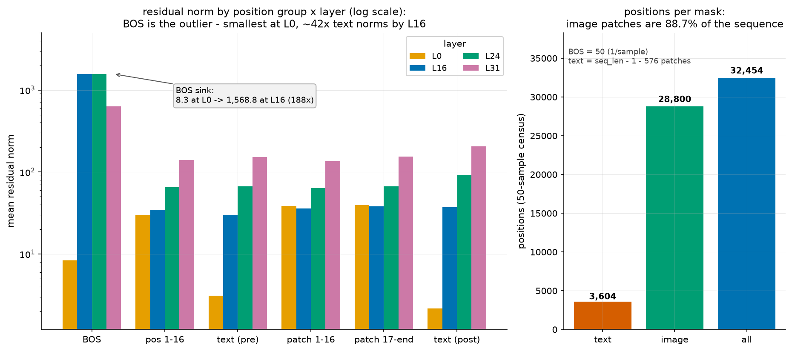
_figA3 — position census over 50 COCO samples: BOS is the sole massive-activation outlier (8.3 → 1568.8, 188×,
then 633.7 at L31); image patches are 88.7% of the 32,454 positions (mask counts text 3604 / image 28800 / all 32454) (`step1/x3_norms.json`)._

### X6 dtype gate (figA1)

- **WHY.** bf16 gradients would make fitting ~13% cheaper — if numerically adequate; a pre-registered rule
  decides before any production fit.
- **HOW.** Same 8 COCO samples, layers 0/8/16/24/30, both legs differing only in `--dtype`: bf16 vs fp32+TF32
  (true fp32 measured ~15× slower un-flagged, D10). Comparator: relative Frobenius, cosine, best-fit scale,
  residual after scale removal. Rule: fp32 if median > 3% or max > 10%.
- **RESULT.** Per-mask medians agree: **1.20% (all), 1.26% (image), 1.48% (text)**. But text/L0 hits **49.2%**
  (cosine 0.88 there; `rel_after_scale` 48.1% — not a scale artifact); all/L0 20.1%, image/L0 4.35%. Rule fires:
  `use_fp32=true`, at 2486.5 s vs 2205.8 s for the same 8 samples = **1.13×**.
- **INTERPRETATION.** Production fits run fp32+TF32; S1's finished bf16 lens stays as a recorded deviation (D18)
  — its gate claim is a ranking claim a 1.5% perturbation cannot flip. The one catastrophic cell is where means
  are uncentered (L0 text), foreshadowing P1.

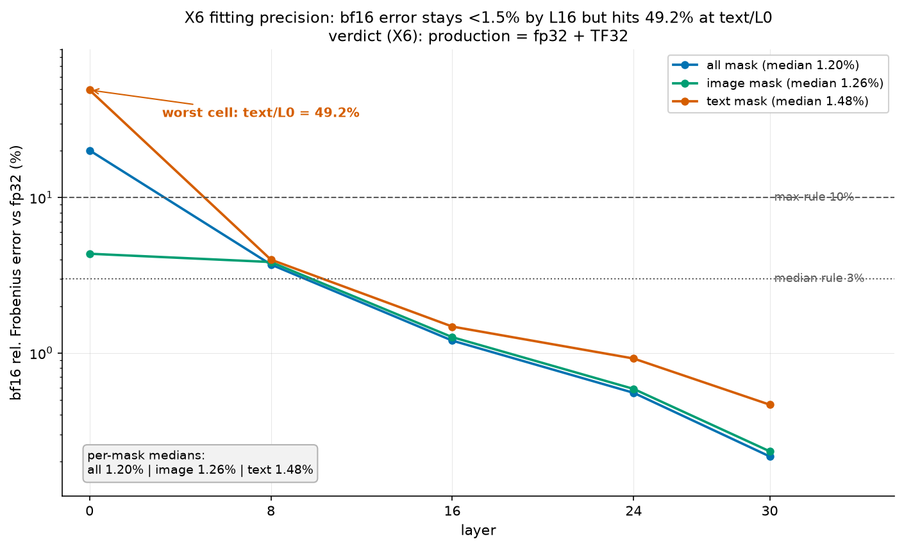
_figA1 — bf16 vs fp32+TF32 Jacobian agreement: per-mask medians 1.20/1.26/1.48% by L16, but text/L0 at 49.2%
(cosine 0.88, not a scale artifact) fires the pre-registered rule → production = fp32+TF32 at 1.13× cost
(`step1/x6_dtype.json`)._

---

## Stage 1 — The instrument (fit + validate + first causal handle)

### S1 text-control fit and gate (figA2)

- **WHY.** Validate the fit→score pipeline on a text-only corpus against pre-registered checks, including the
  strict "never worse than the untrained logit lens in the middle layers" criterion.
- **HOW.** WikiText-103, `skip_first=16`, mask `all`, 31 layers, bf16, 100 prompts; scored on the frozen
  30-prompt held-out shard (`step2/s1_score.json`): identity check (J=I must reproduce the logit lens exactly),
  depth trend, last-layer alignment, unigram frequency control, mid-layer comparison.
- **RESULT.** Identity exact **0.0**; depth trend 885.54 (L16) → **27.31** (L31) mean true-token rank;
  last-layer rank difference **0.0**; frequency control equal to the model at L31 (top-1-in-top-50 0.450, mean
  rank 27.3). The J-lens wins mean rank at L2–16 (L14: 1101.2 vs 5178.4) and L26–30 (L30: 46.5 vs 75.2) — but
  the **strict mid-layer criterion FAILS**: at L17/20/21/23/24 it loses to the logit lens by +379, +813, +331,
  +99, +271 ranks (chance 16032.5; mid-band means 2228.8 vs 2119.3). By KL/top-1 the untrained lens leads L17–30
  (L30 top-1 0.762 vs 0.718): the rank-vs-KL tension.
- **INTERPRETATION.** Conditional pass, the campaign's honest limitation (D19): a comparative nuance, not a
  validity failure. P1 later shows the mid-layer deficit was substantially the uncorrected mean shift — logged
  before the fix, not rounded away.

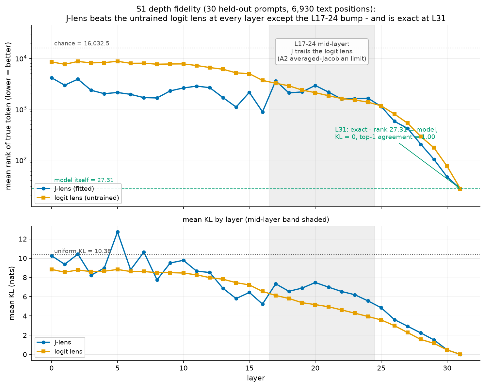
_figA2 — S1 depth fidelity on held-out WikiText: the J-lens beats the untrained logit lens on mean rank at every
layer except the L17–24 bump (2228.8 vs 2119.3), exact at L31 (rank 27.31 = model, KL 0.0, top-1 1.00)
(`step2/s1_score.json`)._

### S2 caption lens

- **WHY.** Does the lens survive on multimodal, on-policy data with held-out scoring and cross-half controls?
- **HOW.** The 100 fit images split by instruction half (A = questions 1–5, B = 6–10; 50 image-disjoint samples
  each); two half-fits then `--merge` (weights by `n_prompts`, so the merge is bit-equivalent to a single
  100-sample run, D7); scored on **300 held-out captions** (`step3/s2_eval.json`); halves cross-scored per
  question-half (no image leakage); cross-corpus transfer both ways.
- **RESULT.** Text-tag rank: L0 26120.6 → L16 **1307.6** → L30 **215.2** → L31 = model (42.62; identity exact,
  agree 1.000, KL 0.000). L16 sits at 30.7× the model ceiling vs S1's 32.4× — the caption lens tracks the text
  lens. Halves are symmetric: lens_a own 233.00 vs cross 231.83; lens_b own 197.81 vs cross 203.15 (correct
  in-domain sign, no leakage; lens_b ~15% stronger — question-half distribution). An L20 bump (2753, +1446 over
  L16) echoed S1's mid-band weakness.
- **INTERPRETATION.** X11 attributed the bump to the **fitted map, not the model** (D37, revising D35/D36): the
  untrained logit lens is monotone through L17–24 (2201.8 at L16 → 1557.9 at L20 → 284.8 at L30) while both
  fitted lenses bump — A2's single-linear-map approximation degrades mid-band, Stage 2's target. Transfer keeps
  the rank-vs-KL tension honest: S1 wins L30 rank on captions (109.49 vs 215.21), S2 wins agree/KL (0.729/0.428
  vs 0.706/0.474).
  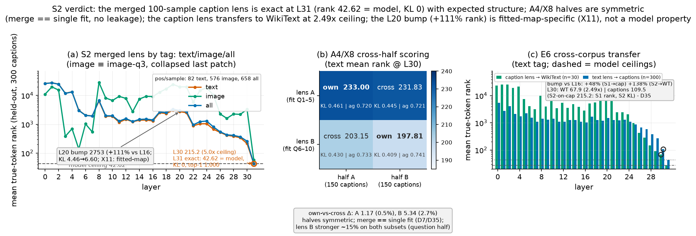
  _figD9 — S2 caption lens (`step3/s2_eval.json`): merged 100-sample lens text-tag rank 26120.6 → 1307.6 (L16) →
  215.2 (L30) → 42.62 at L31 (identity exact); instruction halves symmetric (lens_a own 233.00 vs cross 231.83;
  lens_b 197.81 vs 203.15 — merge ≡ single fit, D7/D35); cross-corpus transfer: the caption lens reads WikiText
  at 2.49× ceiling (L30 67.9 vs 27.28), the text lens reads captions at 109.49 rank — and the L20 bump appears in
  both transfers, the fitted-map signature X11 pinned on the map, not the model (D37)._

### X1 target-mask separation (V1)

- **WHY.** Register V1: text sources after the image block cannot causally reach image targets, so the cotangent
  seeded at image targets must live in different rows than the next-text cotangent — otherwise image-position
  readouts would be next-text predictions.
- **HOW.** The same 20-image shard fitted twice: `target_mask=all` vs `target_mask=text` (cotangent seeded only
  at requested positions; D2). Hard criterion: text rows `torch.equal`-identical between variants, image rows
  different; a lens-level table quantifies image-row movement (`step4/x1_targetmask.json`).
- **RESULT.** The bit-identity criterion failed as stated — the variants are separate fit invocations, so
  full-variant text rows differ only at the TF32/atomics run-to-run noise floor (rel_fro 1.37e-2 at L0 → 1.75e-6
  at L30, the X6-era floor); the unit test on the causally-disjoint subset passes (D3/D36), and the float64
  compare re-run was deferred after three OOMs, its analytic justification standing (D38). The real signal: with
  the image block before the text, **image rows move by rel_fro 24.5 (L0) → 27.4 (L8) → 38.1 (L16) → 103 (L24) →
  255 (L30) while cosine collapses 0.39 → 0.09** — a ~180–1500× separation from text-row movement. Lens-level:
  image J moves 23.7 → 115.6 with best-fit scale 8–28× (the image→image cotangent mass is 8–28× larger,
  near-orthogonal); aggregate text rows differ 2.12 (L0) → 0.17 (L30), explained by `USER:` tokens preceding the
  image block, which do reach placeholder targets (pre-registered, D3).
- **INTERPRETATION.** **V1 confirmed**: image rows are not next-text predictors; a readout at an image position
  is a first-order disposition to verbalize, not a prediction — binding Stages 3–4.

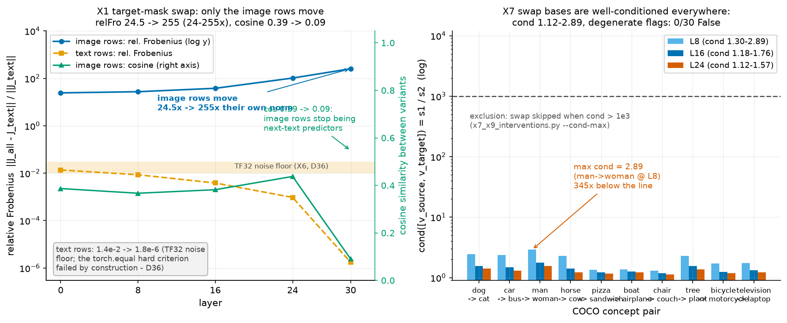
_figD1 — target-mask separation and swap-basis conditioning (`step4/x1_targetmask.json`, `x7_x9.json`): image
rows move rel_fro 24.5 → 255 (L0 → L30) while cosine collapses 0.39 → 0.09; text rows differ only at the TF32
noise floor (1.37e-2 → 1.75e-6; the `torch.equal` criterion failed by construction, D36) — V1 confirmed. Right:
all 10 COCO pair bases are well-conditioned (cond 1.30–2.89 at L8/16/24, ~345× below the 1e3 exclusion line)._

### X7 conditioning and X9 edit sweep (figB1)

- **WHY.** Are the lens's directions (rows of `W_U J_l`) a live causal handle: well-conditioned swap bases, and
  generations that actually change?
- **HOW.** X7: condition number of the 2-column swap basis `[v_s, v_t]` for 10 COCO concept pairs at L8/16/24
  (exclude at cond > 1e3). X9: greedy generations on held-out captions with add/ablate/swap at L16/24 over an
  alpha grid; x9b extends to 2800 generations (D40); directionality mining on the 215 changed generations (D39).
- **RESULT.** X7: 30 entries (10 pairs × L8/L16/L24 in `raw/step4/x7_x9.json` `x7_conditioning`),
  **cond ∈ [1.12, 2.89]** — all far below the exclusion threshold; cosine 0.10–0.78, norms source
  0.83–1.47 / target 0.87–1.58, `degenerate=false` everywhere. X9: **215/1400 generations changed** (15.4%; add 161, ablate
  32, swap 22); edits bite early (first-diff tokens cluster at caption positions 10–14 and 1–3; add@L16 91 vs
  add@L24 70). Dose-response is monotone (figB1): ablate 7/16/24/34% and swap 7/12/24/39% at alpha 0.5/1/2/4;
  swap@L24 reaches 35% at alpha 4. But **direction is rare**: 7 of 215 changed generations (3.3%) are
  concept-directed, needing alpha ≈ 5–14× the residual norm (e.g. `man→woman add@L24 α=13.81` → "The woman is
  the main focus"); at alpha ≈ 1–3×, 85% of edits leave the greedy path unchanged.
- **INTERPRETATION.** The E5 minimal bar passes; the strong bar (cheap directed control) fails at this scaling —
  a J-vector edit moves the state mostly along directions with weak logit effect. P5's span-overlap measurement
  supplies the mechanism; H1/H2 propose the fixes.

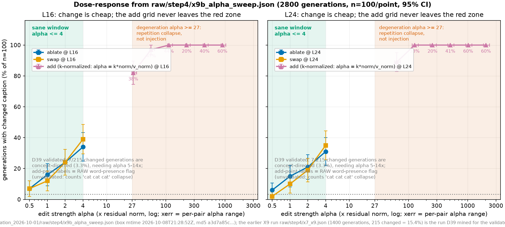
_figB1 — edit dose-response, JSON-grounded from `raw/step4/x9b_alpha_sweep.json` (the x9b sweep itself: 2800
generations, 10 pairs × 10 samples × L16/L24, n=100 per point with 95% CI; synced from the box's
`/data/anhnq/vlm-lens-out/validation/step4/`, mtime 2026-10-08T21:28:52Z, md5-identical to the local copy): the
**add series** (pink triangles, previously absent) runs at k-normalized α ≈ 27–2348 — entirely inside the
degeneration zone — carrying per-point labels of its RAW word-presence "directed" fraction (20–60%,
unvalidated: counts repetition collapse); ablate 7→34% @L16 / 6→31% @L24 and swap 7→39% @L16 / 2→35% @L24
across α = 0.5/1/2/4 (xerr = per-pair alpha spread on the k-normalized arms); the validated figure is the grey
line — D39's 7/215 = 3.3% concept-directed of the earlier X9 run (`raw/step4/x7_x9.json`: 1400 generations,
215 changed), needing α ≈ 5–14× (D39/D40)._

---

## Stage 2 — Improving the lens (the model-class ladder)

### Metric redesign

- **WHY.** Mean rank over a 32k vocabulary is tail-dominated; if the lens is good for the typical position,
  means hide it.
- **HOW.** `lens_zoo_eval.py` scores mean/median rank, top-1/5/10/50 agreement, mean KL and a composite LQS on
  the 300-sample held-out set; cross-run determinism checked against historical scores.
- **RESULT.** Medians unmask the lens: L16 mean 1307.6 but **median 15**; L24 mean 1047.5, median 4; L30 mean
  215.2, **median 1**, top-10 agreement 0.886. The re-scored merged lens reproduces the historical ranks exactly
  (L30 215.21).
- **INTERPRETATION.** For the typical position the lens nearly solves next-token prediction from L16 on; later
  model-class comparisons use this multi-metric view.

### P1 affine correction from a moment census

- **WHY.** X6's L0 cell and S1/S2's mid-band bump both look like an uncorrected mean shift between intermediate
  and final residual states, not a variance limit of the linear map.
- **HOW.** `moment_census.py` measures per-layer `E[h]` and `E[h_final]` on 100 corpus samples (text mask, 7144
  positions); the readout applies `h_final ≈ b_l + s_l (J_l h_l)` with `b_l = E[h_f] − J_l E[h_l]`, `s_l = <t,
h_f>/||t||²`; a clamp variant clips `s_l` to [0.5, 2.0] (the raw census scale is noisy early: `s_0 = −3.19`).
- **RESULT.** On the 300-sample held-out (tag=text): L20 rank 2753.0 → **811.3**; L30 215.2 → 76.9; the bump
  ratio (L20/L16) collapses **2.11 → 0.68**; L30 ratio 5.05 → 1.80. The clamp fixes the early blowup: KL at L0–4
  **21.9 → 7.0** (better than the unbiased 9.6–15.6), rank ratio 706 → 46; LQS climbs **−0.102 → +0.335
  (unbiased) → +0.766 (clamped)**; layers 5–30 unchanged; one mild KL regression at L9–16 (+0.4–0.7).
- **INTERPRETATION.** The D19 limitation was substantially the uncorrected mean shift: with bias+clamp, L17–24
  becomes the lens's _best_ zone (KL 2.6–4.0 vs unbiased 5.0–6.6; L20 rank ratio 19.0 vs 64.6), superseding
  D39(c). What survives is A2's true variance limit — the translator class's job.

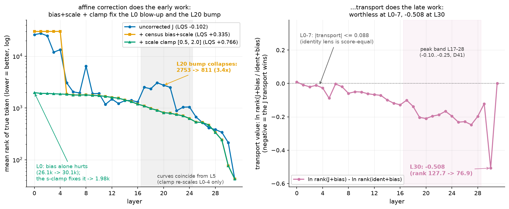
_figD2 — the affine correction and the transport decomposition (`step4/lens_zoo{,_biased,_biased_clamped}.json`,
`step5/lens_zoo_{ident,cal}.json`): bias+scale collapses the mid-band bump (L20 rank 2753.0 → 811.3; ratio
2.11 → 0.68) and the clamp fixes the L0–4 blowup (KL 21.9 → 7.0; LQS −0.102 → +0.335 → +0.766); transport is
worthless at L0–7, peaks across L17–28, and delivers −0.508 at L30 (rank 127.7 → 76.9) — affine does the early
work, transport the late work (D40/D41)._

### P5 model-class ladder (figA4)

- **WHY.** Where does the J's value live — transport (`J_l` vs identity), affine correction, or calibration? Can
  cheaper classes (diagonal, shifted, rank-truncated, distilled translators) do the same job?
- **HOW.** Complete ladder on the 300-sample held-out (tag=text), zero new Jacobian fits: J-structure analysis
  (`jacobian_structure.py`), transport decomposition (identity lens with the same payload), span overlap against
  `W_U`'s readout span, calibration ablations.
- **RESULT.** LQS ladder: untrained logit lens 0.000; scaled identity 0.000 (exact); rank64/ rank256 truncated J
  −0.587/−0.284; full J uncorrected −0.102; **diag(J) +0.374**; shiftP4 +0.524; ident+bias +0.647; **J + census
  bias+scale +0.766**; **+logit_bias +0.922** (a win at every layer, 2–23%, after fixing a wrong-sign first
  attempt that cost −0.100); **lowrankJ (rank-32 KL translator on `J_l h`) 1.714 ≈ lowrankRaw (pure tuned lens)
  1.718**. Transport decomposition: identity with the same payload scores +0.647 vs J's +0.766 — transport adds
  +0.119 (16% of the fix); worthless at L0–7, growing through L8–16, peaking **−0.508 at L30 (127.7 → 76.9
  rank)**: affine does the early work, transport the late work. Structure: `trace(J)/d` crosses 1 at L20–23
  (0.05 at L0, 1.04 peak at L25); top-64 singular directions carry 87.5% of the energy at L0 but 9.9% at L30;
  diag carries 0.04–5.3% of the Frobenius mass. **Rank compression loses** — truncating J strips the
  near-identity mass (its ~4096 equal singular values), leaving exactly the uncorrected off-diagonal; the J's
  value is not low-rank. Span overlap: the J's top-64 directions carry only **3.5–10.6% energy in `W_U`'s
  readout span** (random baseline 3.1%) — at chance early, **3.4× chance at L30** — mechanistically explaining
  why J-vector edits need ~10–30× residual-level magnitude to move logits (D39's alpha 5–15×, x9b's α≥27
  breakdown). Cross-layer span overlap vs the final layer is near chance (0.0002–0.006) until L16, then
  0.018–0.050 at L20–26 (75–200× chance — the tuned lens's covariance drift, quantified).
- **INTERPRETATION.** The ladder is complete: the J-lens's unique value over the tuned lens is late-layer
  transport; the translator's value is mid-layer; the affine correction (bias+scale+logit_bias) is necessary
  everywhere. Best J readout at this point: +0.922 (L30 ratio 1.79) — until the tmtext refit and the scaling
  revision below.

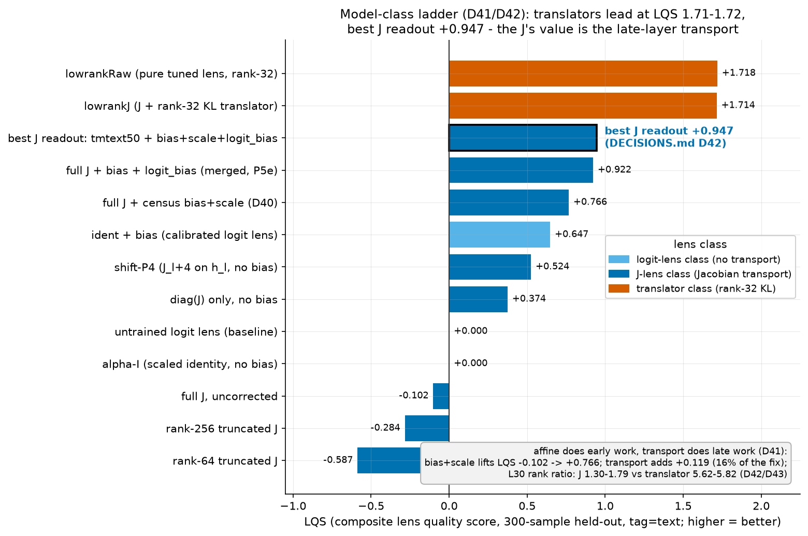
_figA4 — the model-class ladder (LQS on 300 held-out captions): diag(J) +0.374, shiftP4 +0.524, ident+bias
+0.647, J+bias+scale +0.766, +logit_bias +0.922, tmtext50+payload +0.947; rank-32 translators lead overall
(1.714/1.718) but lose 3× at L30 (5.62–5.82 vs 1.30–1.79) (DECISIONS.md D41/D42)._

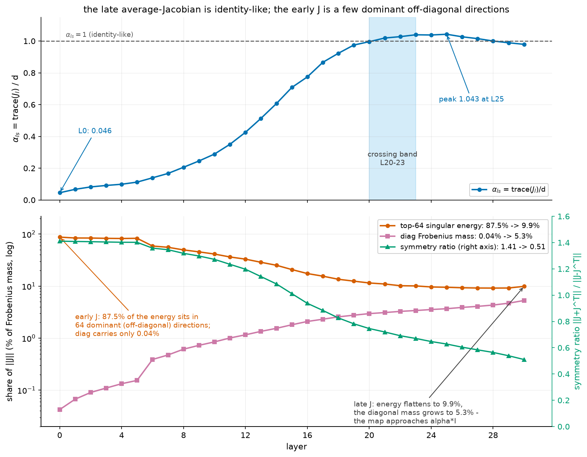
_figD3 — the average-Jacobian becomes identity-like (`step5/jacobian_structure.json`): α_ls = trace(J)/d crosses
1 across L20–23 (0.046 → 1.043); the early J is a few dominant off-diagonal directions (top-64 energy 87.5% at
L0 → 9.9% at L30; symmetry 1.41 → 0.51; diag mass 0.04 → 5.3%) — which is why rank compression loses: truncation
strips exactly the near-identity mass that carries the late-layer value (D41)._

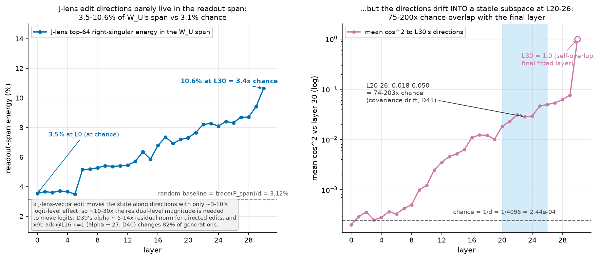
_figD4 — span overlap explains the edit thresholds (`step5/span_overlap.json`): the J's top-64 right-singular
directions carry only 3.5–10.6% energy in `W_U`'s readout span (chance 3.125%), so a residual-level edit needs
~10–30× magnitude to move logits (D39's α 5–14×; x9b's α ≈ 27 → 82% change); cross-layer overlap vs the final
layer stays near chance (2.4e-4) until L16, then 0.018–0.050 across L20–26 — 75–200× chance, the tuned lens's
covariance drift quantified (D41)._

### P3 alpha sweep (figB1, above)

- **WHY.** Map the sane operating window: where does "change the caption" stop being "direct the caption"?
- **HOW.** x9b: 2800 greedy generations, add/ablate/swap at L16/L24, one `ResidualEdit` per generation
  (`positions="last"`); per-row `directed` flag = raw word-presence check (target word appears in the output and
  not in the baseline), reproducible against an independent recomputation 2800/2800 (D40). The stricter
  **validated** mining is D39's, on the earlier X9 run; its per-generation output was not archived.
- **RESULT.** Change is monotone in alpha (figB1; L16/L24 arms per `raw/step4/x9b_alpha_sweep.json`,
  n=100 per point: ablate 7/16/24/34% and 6/15/21/31%, swap 7/12/24/39% and 2/10/19/35%). The add grid ran at
  k-normalized **α ≈ 27–2348** (per-pair alpha = k·norm/v_norm; median per cell 28–902 @L16 and 64–2035 @L24;
  raw row range 26.8–2348.2; its "k=1" label is really α≈28 at L16, 64 at L24 — verified against the archived
  JSON, correcting the earlier "27–1035 / 58 at L24" transcription), so it **never leaves the degeneration zone**;
  the only sane-window add data is D39's earlier grid (α 1.34–14.68, 10–80% change), not archived. In the archived
  JSON the raw flag's sane-window rate is ablate 5/200 and swap 12/200 (3.2%/8.1% **of changed**; the flag counts
  collapse as directed) — the earlier "0.5–3% (1–2/200, 0–6/200)" traces to D39's validated mining on the earlier
  run. At **α ≥ 27** the add "directed" rows are dominated by degeneration: `dog→cat add@L16` yields
  "cat cat cat cat ...", a repetition collapse — breakdown, not injection.
- **INTERPRETATION.** Change is cheap, direction is rare (D39's 7/215 = 3.3% of changed remains the validated
  reference), large-alpha effects are model breakdown; protocols must report residual-relative alpha, never the
  k label (D40). The full dose-response is now regenerable: `python
  results/validation_2026-10-01/code/figures_hallucination.py` rebuilds figB1 from `raw/step4/*.json`.

### target_mask=text refit (D42)

- **WHY.** D40's n=20 probe flagged `target_mask=text` (excluding the image block's next-image-token targets) as
  the best data lever; does it hold at n=50, and does it compose with the calibration payload?
- **HOW.** 23.7-h refit: 50 samples, all layers, fp32+TF32, `target_mask=text`; scored bare and composed with
  the best payload (census bias+scale + logit_bias) on the 300-sample held-out
  (`step4/lens_zoo_tmtext{,_cal}.json`).
- **RESULT.** Bare: LQS **+0.337**, L30 ratio 2.667 — **+0.44 LQS over the all-target merged lens**, stable
  across sample counts. Composed: **LQS +0.947, L30 ratio 1.30** — the best late-layer readout measured, J or
  translator (rank-32 translators sit at L30 5.62–5.82). Mid-layer stays behind (L16 37.7, L20 30.8 vs
  merged+payload 21.4/15.3).
- **INTERPRETATION.** Image-target exclusion sharpens exactly the late image→text handoff layers and costs
  mid-layer sharpness — the mask choice is a dial between regimes, and the deployment recipe splits by regime.

### Data scaling (figA5)

- **WHY.** The J-class looked flat from n=20 to n=100 (D40): is that sample-count saturation or the model class?
  And does the winning translator class keep scaling?
- **HOW.** Two scaling curves on disjoint nested corpora, scored on the 300-sample held-out (tag=text). J-class:
  an online probe (`fit_masked --probe-every`) scores the running mean-J on 16 held-out samples every 5 fit
  samples. Translator class: rank-32 KL distillation to the model's own logits from a CPU-resident activation
  cache, at n = 40/100/500/1000.
- **RESULT.** J-class saturates at ~100: intra-fit text-KL 6.305 (n=5) → 6.043 (10) → 5.989 (15), decelerating;
  image-position KL flat throughout (11.51/11.58/11.53 — V1's echo); its value is the moment census, converging
  ~1/sqrt(n) over 7k positions by n≈100. The translator class does **not** saturate: fit-side val_kl 1.424 (40)
  → 0.888 (1000), but held-out LQS keeps rising ~log-linearly: **1.714 (40) → 2.043 (100) → 2.691 (500) → 3.009
  (1000)** (~0.4 LQS per e-fold; rung deltas +0.329/+0.648/+0.318); fit-KL decouples from the rank metric (the
  D19 tension at scale). Per layer at n=1000 the translator reaches L30 ratio **1.30** — parity with the best
  J-lens (1.30), from 5.82 at n=40 (3.90/2.05 in between).
- **INTERPRETATION.** **REVISION (supersedes D41/D42): the late-layer transport advantage was a small-data
  artifact** — the translator's late-layer weakness decays with data exactly to the J-lens's level. Production
  recommendation: rank-32 KL translator at n ≥ 1000 for readouts (keep scaling; ~1–2 h per 1000 samples with the
  CPU cache); the J-lens (zero-fit, ~1 h total with the moment census) as the cheap fallback (LQS 0.92–0.95);
  the J keeps the causal-edit handle.

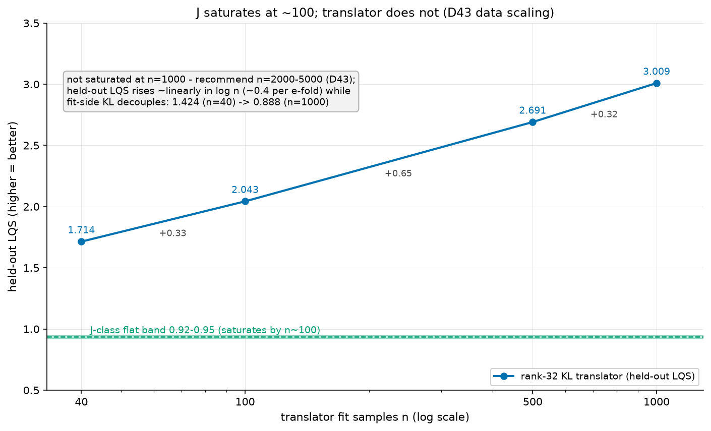
_figA5 — data scaling: the J-class is saturated by n≈100 (LQS 0.92–0.95) while the rank-32 translator's held-out
LQS rises ~0.4 per e-fold of data (1.714@40 → 2.043@100 → 2.691@500 → 3.009@1000), reaching J-lens parity at L30
(1.30) — the late-layer transport advantage was a small-data artifact (DECISIONS.md D43)._

---

## Stage 3 — Hallucination mechanisms (the causal story)

### X12 commitment boundary (figB3)

- **WHY.** Until which layer is visual content causally live at image positions — the window in which a
  hallucination could be prevented rather than cured?
- **HOW.** Cross-image patching: 8 disjoint-object COCO pairs; replace A's 576 image-token rows with B's at a
  single layer; measure caption change, A-object vanishing, B-object appearing; single-position
  (last-image-token) and text-position controls (`step10/x12_cross_image_patch.json`).
- **RESULT.** All-576-patch changes flip the caption at rate **1.00 / 1.00 / 1.00 / 1.00 / 0.875 / 0.125 / 0.50
  / 0.25 across L0/8/12/16/20/24/28/30**; A-objects vanish 1.00 → 0 by L24; B-objects appear 0.406–0.490 only
  through L16, then ~0. Single-token patches do nothing (**≤ 0.25**); text-position controls sit at the
  0.12–0.37 floor.
- **INTERPRETATION.** The commitment boundary sits at **L16–20**: re-writing image tokens after L20–24 no longer
  changes the caption, and the content is distributed — no single handoff token stores it. Prevention must
  happen mid-stack; cure at the handoff layers.

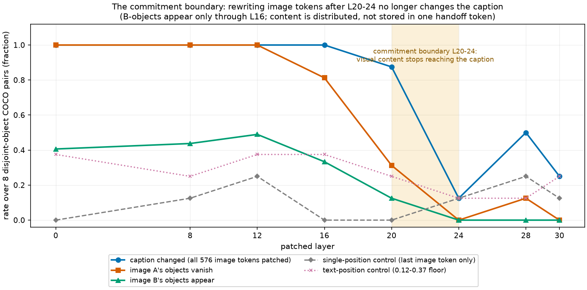
_figB3 — cross-image patching (8 pairs): patching all 576 image tokens changes the caption at rate 1.00 → 0.125
across L0–24 (A-objects vanish by L24; B-objects appear only through L16); single-token patches do nothing (≤
0.25) — visual content is causally live at image positions only until ~L16–20
(`raw/step10/x12_cross_image_patch.json`)._

### X14 prior-vs-grounding race and the text-mediated handoff (figB4)

- **WHY.** Is a hallucinated word suppressed knowledge ("knows but commits anyway") or the prior's default that
  grounding must overtake — and where does image content reach the verbal stream?
- **HOW.** 24 images, calibrated logit lens (identity transport + moment payload — zero fitting beyond moments);
  lens-rank trajectories of hallucinated vs grounded generated words, of the image's true categories at the last
  image-token vs the last prompt position, and of truth at the hallucinated words' decoding positions
  (`step10/x14_workspace_probe.json`).
- **RESULT.** The prior leads from the start: hallucinated generated words are high-ranked **from L0 (rank ~787
  vs grounded ~5358 — 7×)**, while grounded words are built up monotonically (5358 → 1.18). The trajectories
  **cross at L24–26** (L24: grounded 4.86 vs hallucinated 6.5; L26: 1.18 vs 4.5). The handoff is text-mediated:
  the image's true categories rank ~1200–2000 at the last IMAGE-token position at every layer (never decodable
  there), but at the **last PROMPT position** the best-per-image true object rank falls **1423 (L16) → 34 (L20)
  → 6–15 (L22–25)**; then the L31 readout flips to the imminent token (mean rank 3464 — the motor regime).
  DOES-THE-MODEL-KNOW is **negative**: at the hallucinated words' decoding positions the image's actual
  categories rank ~16–35 through L20–30, vs the hallucinated word's 2–6. Separability at L30: grounded 1.18 vs
  hallucinated 6.0.
- **INTERPRETATION.** Hallucination is the prior winning, not suppressed knowledge: the model does not represent
  the truth competitively at the commitment positions. Grounding is a computation that overtakes the prior in a
  narrow band (L20–25) at a specific location (last prompt position) — exactly the X12 boundary and the D41–D43
  transport zone.

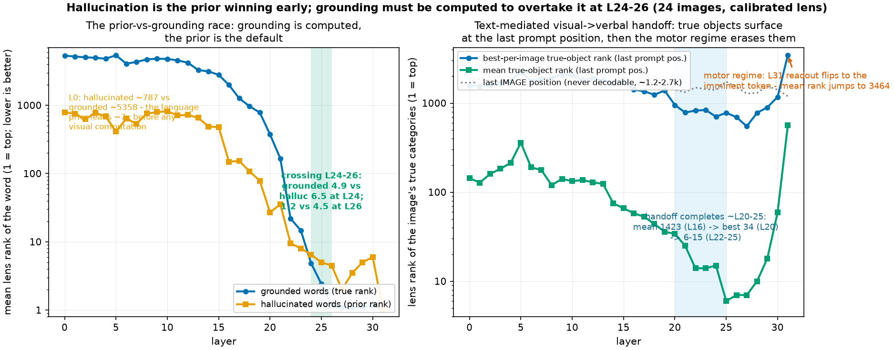
_figB4 — the prior-vs-grounding race (24 images): hallucinated words rank ~787 vs grounded ~5358 at L0;
grounding overtakes at L24–26; the image's true objects surface only at the last prompt position (1423 → 34 →
6–15 across L16→L20→L22–25) and the L31 motor flip moves the readout to the imminent token (mean rank 3464)
(`raw/step10/x14_workspace_probe.json`)._

### X13 cure test (figB2)

- **WHY.** D39's open item: does ablating the hallucinated concept's J-lens direction remove the hallucination —
  and is the ablation surgical?
- **HOW.** 39 images, 10 hallucination arms vs COCO-instances ground truth; mean-replacement ablation of the
  hallucinated category's J-lens-vector direction at alpha=1, at L16/24/28/30; control = ablating a GROUNDED
  category's direction (36 control arms) (`step10/x13_cure_test.json`).
- **RESULT.** Hallucinations removed **0.50 / 0.60 / 0.70 / 0.90 at L16/24/28/30** with grounded-category
  retention **1.00 / 1.00 / 1.00 / 1.00** on the same arms. The control is destructive: grounded retention falls
  **0.97 → 0.79 → 0.52 → 0.35** across the same layers.
- **INTERPRETATION.** A training-free, single-direction **90% surgical cure at L30**: the hallucinated concept's
  direction is causally load-bearing for the unsupported token while grounded content survives it. The layer
  dose-response matches the X14 crossing — the cure improves as grounding overtakes the prior.

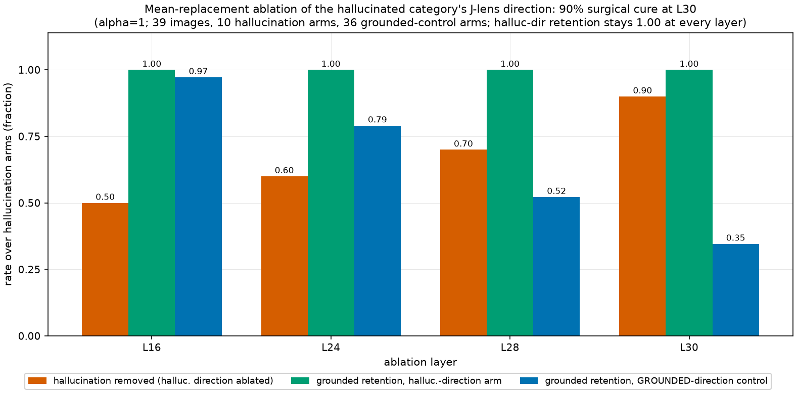
_figB2 — the cure test (39 images): mean-replacement ablation of the hallucinated concept's J-lens direction
(α=1) removes 0.50/0.60/0.70/0.90 of hallucinations at L16/24/28/30 with grounded retention 1.00, while ablating
a GROUNDED category's direction destroys retention 0.97 → 0.35 — a training-free 90% surgical cure at L30
(`raw/step10/x13_cure_test.json`)._

### Scale-ups at power (D45/D46)

- **WHY.** D44's round left held-out predictions; the scale-ups test them at adequate n: pre-generation
  detection, sink clamping, the attention mirror, hesitation, and image-level fusion.
- **HOW / RESULT.** One sequential chain, all training-free, single-forward unless noted (`step11/*.json`):
- **X18 POPE pre-generation gap**: 49 images, 185 questions (87 present / 98 absent); model POPE accuracy 94.1%
  (present 96.6 / absent 91.8), 8 hallucinated yes. One forward at the last prompt position + the calibrated
  lens: **AUROC(present vs absent) = 0.985 at L28** (0.982–0.985 across L20–30); mean gap +5.28 (present) vs
  −4.97 (absent). The lens disagrees with the model exactly on its wrong affirmations: **0.895 as a low-gap
  detector of the model's own hallucinated yes**.
- **X16 sink clamp**: 20 images, top-16 dims per (layer × position group), zero-clamp at L16/24/28/30. The **BOS
  sink is load-bearing**: clamping it collapses grounded retention (0.278 at L16 BOS; 0.222 all-groups) and
  explodes the handoff true-object rank (+1433 at L16, +550 at L28). **Image-token massive dims are nearly
  inert** (retention 0.94–1.00; rank deltas −43..+330). The BOS dim set is **identical across L16–30**
  (`[2533, 1415, 1076, 1512, 2789, 2298, 2158, 3431, 339, 3209, 2469, 257, 4071, 2350, 788, 2235]`);
  image/text groups share 1512/2789/1076 and drop the BOS-specific 2533/1415 — the sink is position-typed.
- **X17 attention mirror**: CLS→patch vs text→image Spearman. At n=200 the curve **replicates**: rho 0.105 (L0)
  → 0.341 (L4) → 0.463 (L12) → 0.577 (L16) → **0.645 (L20)** → 0.403 (L24) → 0.199 (L30) — the LLM's access to
  the image first mirrors the vision tower, then the verbal workspace takes over. But the **hallucination join
  is NULL at power** (27 hallucinating / 170 clean): share_mid AUROC **0.501**, r_pb −0.10 on a 0.4–0.57 mean
  — attention allocation does not predict hallucination.
- **X15 hesitation**: at n=200 (385 grounded / 39 hallucinated word-completion steps), hallucinated steps show
  entropy **0.963 vs 0.620**, margin 4.53 vs 5.55, logprob −0.384 vs −0.230. AUROC (hallucinated positive):
  model entropy 0.593, margin 0.426; **calibrated-lens entropy beats the model's own (L7: 0.730**; L4–7
  0.63–0.73; near chance L11+). Direction confirmed at power; as a per-word detector it is modest.
- **X19 image-level fusion**: 197 images (27 hallucinating): mean per-step lens entropy AUROC 0.620 (L28);
  pre-generation true-category gap 0.632 (L30); **fused z(mean entropy) + z(gap) 0.666 (L30)** — the fusion
  beats its components.
- **INTERPRETATION.** The pre-generation object-presence question is nearly solved by a single forward;
  attention is exonerated; per-word uncertainty is real but weak; the components of image-level risk are
  complementary (H8).

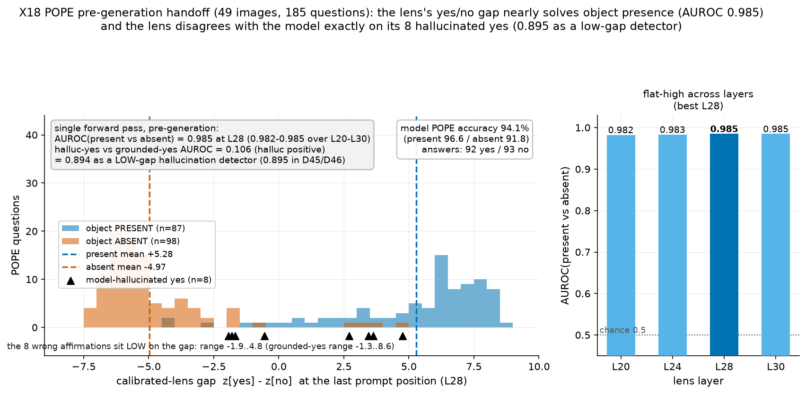
_figD5 — the pre-generation POPE handoff (`step11/x18_pope_handoff.json`): the calibrated lens's z[yes]−z[no]
gap at the last prompt position separates present (mean +5.28, n=87) from absent (−4.97, n=98) questions at
AUROC 0.985 (L28), and the model's 8 hallucinated yes-answers sit low-gap (halluc-positive AUROC 0.106 → 0.894
as a low-gap detector) — a training-free, single-forward truth readout (D45/D46)._

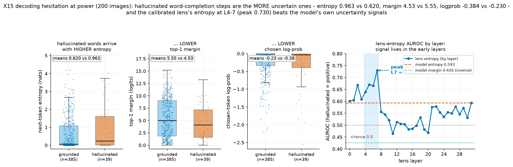
_figD6 — decoding-time uncertainty (`step11/x15_hesitation_n200.json`): hallucinated word-completion steps are
measurably more hesitant (entropy 0.963 vs 0.620, margin 4.53 vs 5.55, logprob −0.384 vs −0.230; n = 39/385),
and the calibrated lens's entropy is the better signal — AUROC 0.730 at L7 vs the model's own 0.593 — with
signal concentrated at L4–7 (D46)._

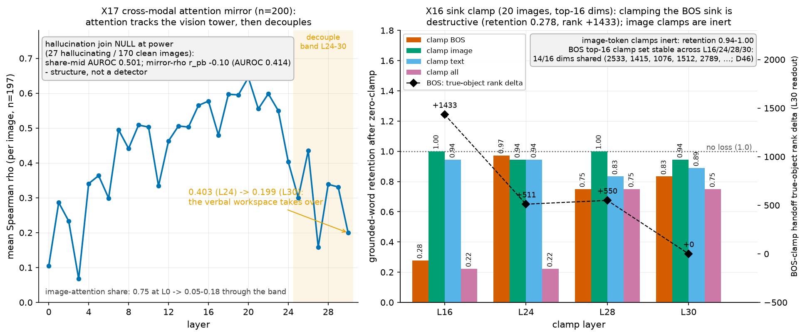
_figD7 — attention mirrors, sinks anchor (`step11/x17_attention_mirror_n200.json`, `x16_sink_clamp.json`): the
CLS→patch ↔ text→image Spearman mirror replicates at 10× n (0.105 → 0.645 at L20 → 0.199 at L30: vision tower
early, verbal workspace late) but does not predict hallucination (join AUROC 0.501 — clean null). The BOS
massive-activation sink is load-bearing (clamping collapses grounded retention to 0.278 at L16 and explodes the
handoff rank +1433) while image-token massive dims are inert (0.94–1.00); the BOS clamp set is stable across
L16–30 (14/16 dims shared, recomputed from the JSON; D46 records the set)._

### The detector ledger (figB5)

- **WHY.** One comparable table for every training-free hallucination signal measured in Stages 3–4. All signals
  are moments-only, single pass unless noted; ns from D45/D46.

| Signal (training-free)                            | AUROC               | n                                                              |
| ------------------------------------------------- | ------------------- | -------------------------------------------------------------- |
| Pre-generation yes/no gap, per question (L28)     | **0.985**           | 185 questions (0.895 catches the model's own hallucinated yes) |
| Pre-generation true-category gap, per image (L30) | 0.632               | 197 images                                                     |
| Per-step lens entropy (L7), per word              | **0.730**           | 39 hallucinated / 385 grounded steps                           |
| Per-step model entropy, per word                  | 0.593               | same 39/385                                                    |
| Image mean lens entropy, per image (L28)          | 0.620               | 197 images                                                     |
| Fused mean entropy + category gap (L30)           | 0.666               | 197 images                                                     |
| Cross-modal attention share / mirror rho (join)   | 0.501 / 0.41 (NULL) | 197 images                                                     |

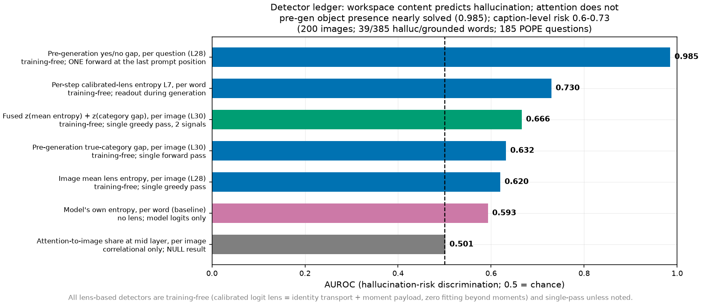
_figB5 — the detector ledger: workspace CONTENT predicts hallucination (pre-generation gap 0.985; per-word lens
entropy 0.730; fused image-level 0.666), attention allocation does not (0.501 NULL); caption-level risk is a
0.6–0.73 problem, pre-generation yes/no is nearly solved (`raw/step11/` JSONs, D46)._

---

## Stage 4 — Global-workspace replication + the VLM novelty

### Paper frame and band mapping

- **WHY.** Gurnee et al. 2026, "Verbalizable Representations Form a Global Workspace in Language Models"
  (transformer-circuits.pub/2026/workspace) claims a mid-layer verbalizable band with sensory/workspace/motor
  trichotomy in frontier text models, with only an anecdotal multimodal check. Does the structure replicate on a
  7B VLM, and what is VLM-specific?
- **HOW.** The upstream repo vendors the paper's experiment data
  (`third_party/jacobian-lens/data/{experiments,evaluations}`); ten scripts (`code/x20`–`x23`) rerun the paper's
  arms on LLaVA-7B plus VLM-only arms (`step12/`, 11 JSONs). The paper's 0–100 band **[38, 92]** maps to
  LLaVA-7B's 32 layers as ~**[12, 29]**.

### Band structure replication (figC1)

- **WHY / HOW.** x22 structure arm (200 prompts): four band metrics — top-1 next-token accuracy, readout
  kurtosis, top-1 autocorrelation, effective dimensionality — plus the multihop depth-precedence and flexgen
  arms on the vendored items.
- **RESULT.** Onsets: autocorrelation **L12** (argmax 24), effective dimensionality **L17** (0.327 → 0.702 in
  band), top-1 accuracy **L20** (argmax 29), kurtosis **L28** (max 3.72) — the four metrics **bracket a band
  ~L17–29** inside the mapped paper band. Depth precedence **replicates almost exactly**: intermediate-swap vs
  answer-swap effective-onset gap **−0.176** vs the paper's ~−0.17 (intermediates are computed and causally used
  before answers); multihop probe pass@1 0.269. Absolute swap success is low (late-band 9.3% vs the paper's
  54–70%), and flexible generalization via J-lens vectors is weak: flexgen **5% at alpha=1 and alpha=2** vs the
  paper's 40/53% (loading-success Pearson +0.256, right sign).
- **INTERPRETATION.** The sensory/workspace/motor trichotomy is present at 7B; causal leverage on it is not
  frontier-grade.

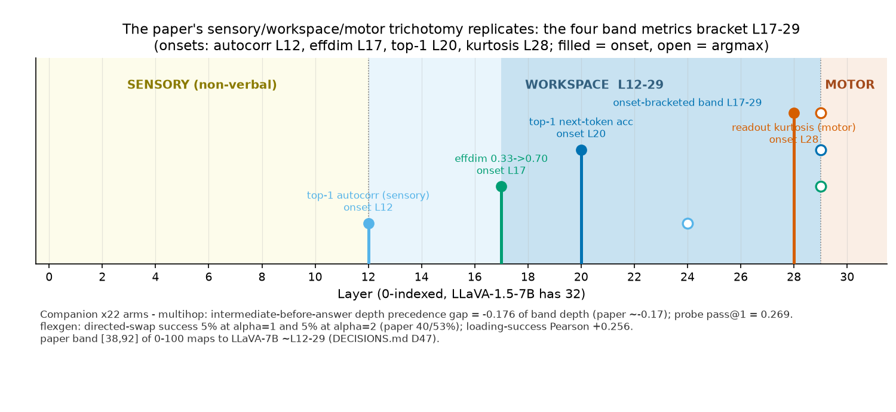
_figC1 — band structure on LLaVA-7B: four onset metrics (autocorr L12, effdim L17, top-1 L20, kurtosis L28)
bracket a workspace band L17–29 inside the mapped paper band [12, 29]; depth precedence replicates (−0.176 vs
paper −0.17); flexgen is weak (5% vs 40/53%) (`raw/step12/x22*reasoning_structure*_.json`).\*

### Lens beats logit lens at mid-band (figC2)

- **WHY.** The paper's methodological claim: the J-lens reads workspace intermediates better than the logit lens
  in the band. Does it transfer to the VLM?
- **HOW.** x20: six vendored eval suites, J-lens vs calibrated logit lens, pass@10 per layer.
- **RESULT.** The J-lens wins **5/6 suites**: multihop **0.312 vs 0.054 pass@10 at L20** (best 0.484 at L28 vs
  0.366 at L29); multilingual 0.265 vs 0.058 at L20 (best 0.280 vs 0.235); typo 0.125 vs 0.010 at L20 (best
  0.125 vs 0.031); order-ops 0.436 vs 0.327; poetry 0.041 vs 0.020. The **association suite is NULL on both
  variants** (pass@10 = 0 at every layer; gold mean rank ~20,660 of ~32k at L20) — that suite's associations are
  not lens-readable on this model.
- **INTERPRETATION.** The J-lens advantage at workspace mid is architecture-robust (text and multimodal) but
  suite-dependent; the NULL row bounds the claim.

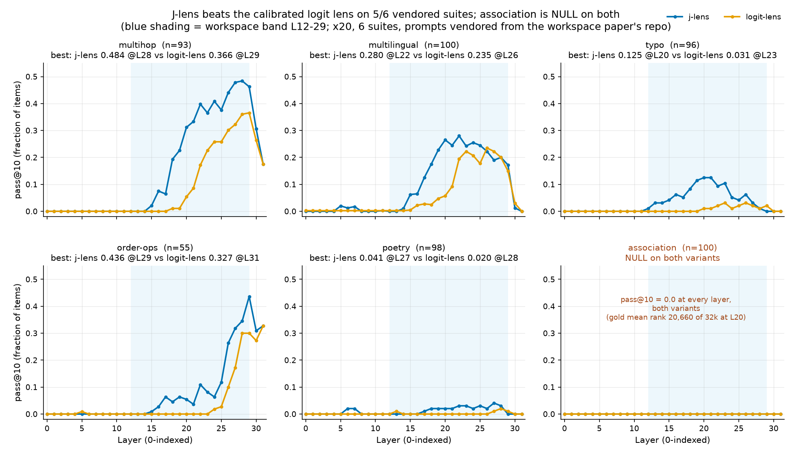
_figC2 — J-lens vs calibrated logit lens on six vendored suites (pass@10 per layer): the J-lens wins 5/6
(multihop 0.312 vs 0.054 at L20; multilingual 0.265 vs 0.058; typo 0.125 vs 0.010), while the association suite
is NULL on both variants (gold rank ~20.7k of 32k) (`raw/step12/x20_lens_evals.json`)._

### Verbal report and introspection (figC3)

- **WHY.** The paper's strongest subjective reports: lens order tracks output order, injected "thoughts" are
  reportable from user-turn (not assistant) positions, directed modulation shows the white-bear effect. Which
  survive at 7B?
- **HOW.** x21 over 14 vendored categories: pooled Spearman between lens order and output order per layer;
  injected-thought introspection with alpha dose; directed modulation; lens-coordinate swaps.
- **RESULT.** Spearman(lens order, output order) at the colon rises **0.475 (L12) → 0.865 (L20) → 0.958 (L29)**
  — the paper's rise replicates. User-turn injection reports the concept **0.65 at alpha=1.0** (0.6 at 0.5,
  dose-responsive) while the **assistant-span control is 0.00 at every strength** — position selectivity
  replicates sharply. Directed modulation: focus **1.00** > ignore **0.60** > baseline **0.20** — including the
  white bear (ignoring primes above baseline); line-count focus 0.40. **Math intermediates (nine→seven) NEVER
  surface** (0.0 in all conditions) — a real capability difference from the paper's frontier models.
  Lens-coordinate swaps flip **9/42 answers (21%)** vs the paper's 59–88%, and never reach top-5 of the
  immediate next-token distribution (flips act through generation).
- **INTERPRETATION.** Report/introspection phenomena are intact at 7B, with weaker swap-based control and a
  genuine capability gap (no math intermediates in the lens).

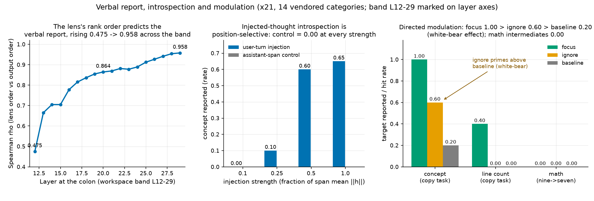
_figC3 — verbal report and introspection: Spearman(lens order, output order) rises 0.475 → 0.865 → 0.958
(L12→L20→L29); user-turn injection reports the injected concept 0.65 at α=1.0 vs assistant control 0.00;
modulation shows the white-bear ordering (focus 1.00 > ignore 0.60 > baseline 0.20); math intermediates never
surface (`raw/step12/x21\__.json`).\*

### VLM-only: ignition and modality-split bands (figC4, figC5)

- **WHY.** Two VLM-native questions the paper never tested: does the visual workspace commit all-or-none
  (ignition), and do the band statistics split by modality?
- **HOW.** x23: (A) image-mixing ignition — blend two images' projected features `f = (1−a) f_A + a f_B`, sweep
  alpha (20 pair-trials × 41 steps), compare the J-space component's 10–90% transition width against the full
  activation's, and correlate the caption's committed-class flip alpha with the lens transition; (B)
  modality-split band statistics — stickiness of top-1 lens content and object-in-top10 rates at image vs text
  positions; (C) cross-modal report swaps (image-sourced concepts) at text/all/image scopes; (D) modulation
  during captioning (590 instructed runs).
- **RESULT.** (A) **Ignition**: the lens transition is **sharper than the full activation's at every layer**
  (width 0.42 vs 0.63 at L12 → 0.28 vs 0.38 at L31) and sharpens with depth; at L28 the caption's committed
  class flips at the **same alpha as the lens transition (Pearson 0.9887**; threshold alpha mean 0.395 vs
  caption flip 0.479; 3/20 trials show a flip within the sampled alphas). (B) **Modality-split bands**: image
  positions carry highly persistent top-1 lens content at every layer (**stickiness z 9.2 at L12 → 18.6 at
  L31**) yet objects appear there **only in the motor regime** (object-in-top10: 0.000 band-wide → 0.006 at L20,
  0.022 at L24, 0.047 at L28, **0.069 at L31**), while text positions stay token-local (z 0.2–2.0) and hold the
  object workspace. (C) Swap-scope ordering **TEXT 1.7% / ALL 2.1% / IMAGE 0.0%** flip rates — the predicted
  ordering holds (image-position swaps do nothing) but absolute rates are tiny. (D) Behavioral concept-mention
  0.37 under instruction; the concept-vs-visual co-occupancy analysis (z 1.35–1.69 in-band over 590 runs) did
  **not** clearly replicate the paper's task-exclusion pattern at this n.
- **INTERPRETATION.** The visual workspace commits all-or-none with a behaviorally aligned readout, and the band
  splits by modality: a **persistent, non-verbal sensory workspace at image positions** whose contents verbalize
  only at the motor regime, with the object-level workspace living at text positions throughout — the band-level
  quantification of D44's text-mediated handoff.

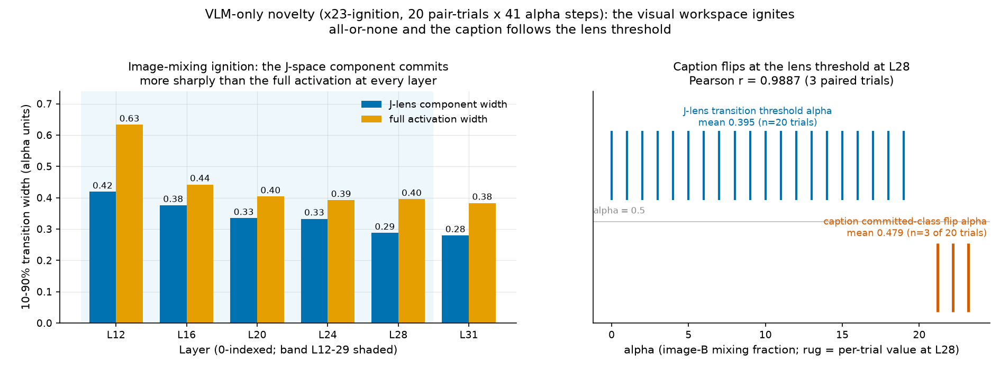
_figC4 — image-mixing ignition (20 pair-trials × 41 alpha steps): the J-space component's 10–90% transition is
sharper than the full activation's at every layer (0.42 vs 0.63 at L12 → 0.28 vs 0.38 at L31) and sharpens with
depth; at L28 the caption's committed class flips at the same alpha as the lens transition (Pearson 0.9887)
(`raw/step12/x23_vlm_workspace_ignition.json`)._

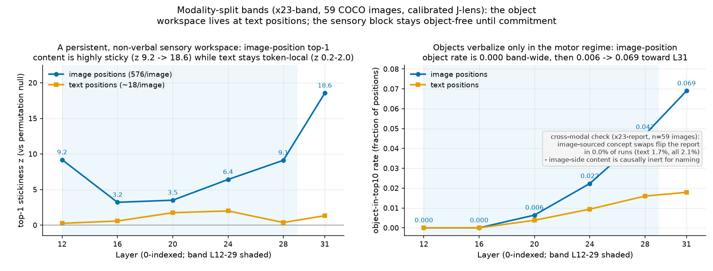
_figC5 — modality-split bands: image positions carry persistent non-verbal lens content (stickiness z 9.2 → 18.6
across L12→L31) while objects appear there only in the motor regime (object-in-top10 0.000 → 0.069); text
positions stay token-local (z 0.2–2.0) and hold the object workspace; image-sourced swaps flip reports 0.0% vs
text 1.7% / all 2.1% (`raw/step12/x23_vlm_workspace_band.json`, `x23_vlm_workspace_report.json`)._

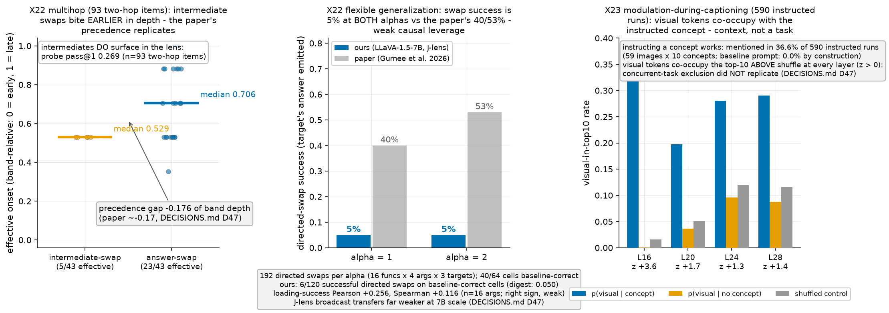
_figD8 — workspace reasoning dynamics (`step12/x22_reasoning_structure_multihop.json`,
`x22_reasoning_structure_flexgen.json`, `x23_vlm_workspace_modulation.json`): two-hop intermediates surface in
the lens and are causally used before answers (effective-onset gap −0.176 vs the paper's ≈−0.17; probe pass@1
0.269); broadcast-style flexible generalization stays weak (5% at both α vs the paper's 40/53%; loading
Pearson +0.256); modulation-during-captioning: concept mention 0.37 of 590 instructed runs, concept-vs-visual
co-occupancy elevated in-band (z 1.3–1.7) without the paper's clear task exclusion (D47)._

### Interpretation

- **STRUCTURE YES, LEVERAGE WEAK.** LLaVA-1.5-7B possesses the J-space's structural workspace properties (band,
  lens > logit lens at mid, report-correlation rise, depth precedence, white-bear modulation, introspection
  selectivity, image-side ignition with caption alignment) while causal control via lens-vector swaps transfers
  poorly at 7B scale (report flips 21% vs 59–88%; flexgen 5% vs 40/53%; image-scope swaps 0.0%).
- **THE STRUCTURAL NOVELTY** is the persistent non-verbal sensory band at image positions — stable workspace
  statistics (stickiness z up to 18.6) that stay object-free until the motor regime — plus the demonstration
  that the object workspace is text-side, quantifying the Stage-3 text-mediated handoff at the band level.

---

## Stage 5 — Architecture and budget generality (D48: the multi-architecture, multi-budget round)

### Multi-architecture fits

- **WHY.** Stages 0–4 are one architecture (LLaVA-1.5-7B, 32L/4096) at one caption budget (`--max-new-tokens` 64);
  no J-space claim is a VLM claim until it survives refitting elsewhere.
- **HOW.** Fit lenses at 64 tokens (the original round; 7b = the production s2-merged) and 256 (re-fit on the same
  seeded image sample; manifests verify median 80-word vs ~40-word captions) for llava-1.5-7b (32L/4096),
  llava-1.5-13b (40L/5120) and Qwen2-VL-7B-Instruct (28L/3584, new `Qwen2VLLensModel`: variable-resolution image
  tokens, M-RoPE/`mm_token_type_ids`, torchvision-free image-only processor). Fits at dim-batch 3 — the estimator's
  `dim_batch=8` expanded graph was the OOM driver (~30 GB retained across 640/1707 backwards) — under supervisor GPU
  queues on the shared node (DECISIONS.md D48).
- **RESULT.** All six model x budget cells fitted and evaluated: `fits/<model>/{s0,s1}` + `merged` (256) +
  `merged-64tok` (renamed 64-token merges; shard copies reclaimed); step13 holds the 20 eval JSONs — x20 lens-evals,
  x21 report, x22 structure, x23 band+ignition, per model x budget (DECISIONS.md D48).
- **INTERPRETATION.** This closes the document's former in-flight framing (multi-arch "built and gated but not
  fitted ... no numbers from these runs are results yet"): the fits and evals exist, and every number below is a
  result (DECISIONS.md D48).

### Caption-budget verdict

- **WHY.** Is the caption budget a real axis of the J-space or a nuisance parameter of the fit corpus?
- **HOW.** 64- vs 256-token lenses on the same seeded image sample, scored per budget on the x20/x21/x22/x23 arms.
- **RESULT.** Mean relative |dJ| **5–16% per layer** — genuinely different lenses — yet workspace properties are
  unchanged: multihop pass@10 0.495 (256) vs 0.500 (64) on 13b; report swaps 10/42 vs (qwen 6 vs 7)/42; band onsets
  identical (13b top1 onset L25 both budgets, qwen L24 both — digest-verified in
  `step13/x22_structure_{llava-13b,qwen2vl}{,_64tok}.json`); ignition widths in the same range (DECISIONS.md D48).
- **INTERPRETATION.** The raw lens moves 5–16% while its functional readouts move ~1–2%: the caption budget is a
  weak axis for the J-space. Byte-identical metrics across budgets indicate near-identical lens content, not a bug —
  T22 proved lens-determinism locally (a 10% dJ change moves every metric), which is also what exposed the
  stale-lens incident in the ledger below (DECISIONS.md D48).

### Architecture verdict

- **WHY.** Do the Stage-4 workspace properties — band, lens > logit lens, report rise, ignition, modality split —
  transfer off the 7B? Same x20/x21/x22/x23 arms per model x budget, same vendored suites; one row per architecture
  (7b at its production 64-token budget, 13b and qwen at 256; DECISIONS.md D48).
- **RESULT.**

| Architecture (budget) | Multihop pass@10 | Report top rho | Report swaps | Band top1 onset/offset | Ignition width lens vs full | Caption-threshold corr |
| --- | --- | --- | --- | --- | --- | --- |
| llava-1.5-7b (64) | 0.484 @L28 | 0.958 | 9/42 | L20/L29 | 0.42 vs 0.63 → 0.28 vs 0.38 | +0.14 (earlier variant +0.99) |
| llava-1.5-13b (256) | 0.495 @L32 | 0.945 | 10/42 | L25/L36 | 0.26–0.35 vs 0.27–0.45 | **−0.81** |
| Qwen2-VL-7B-Instruct (256) | 0.0 (caveat below) | 0.823 | 6/42 | L24/L26 | 0.38–0.58 vs 0.54–0.71 | −0.15 (L23 only) |

- Every cell from (DECISIONS.md D48) except the 7b onset/offset (`step13/x22_structure_llava-7b_64tok.json`) and the
  qwen correlation (`step13/x23_ignition_qwen2vl.json`).
- **INTERPRETATION.** The property set replicates on all three architectures. Qwen's multihop 0.0 is a recorded
  methodology caveat, not a lens failure: the eval suite's gold-token conventions are LLaVA-tuned (the same null on
  both budget variants), and D49's tokenizer-agnostic gold resolution (x20_gold candidate sets + registry
  generation_suffix; llava numbers byte-identical) removes the artifact for future cross-arch runs
  (DECISIONS.md D48/D49). The 13b's NEGATIVE caption-threshold correlation (−0.81: the caption grid flips at
  different alphas than the band-mid lens threshold on this model) vs the 7b's earlier +0.99 is a model-dependent
  divergence deserving a dedicated follow-up (DECISIONS.md D48).

### The universal sensory-block signature

- **WHY.** Is D47's sensory-block finding — persistent, non-verbal image-position content — an artifact of
  LLaVA-7B or a VLM property?
- **HOW.** The x23 band and ignition arms per model x budget: top-1 stickiness z and object-in-top10 rates at image
  vs text positions; J-space vs full-activation alpha-transition widths across the band.
- **RESULT.** Image-position lens content is hyper-persistent (top-1 stickiness z 8–20 at band layers) yet nearly
  object-free through the band (object-in-top10 0.0–2% at onset, rising only to 4–12% at the final layers) on ALL
  THREE models; text positions stay token-local (z 0–2) throughout. Ignition is architecture-general: the J-space
  component's alpha-transition is sharper than the full activation's at every band layer on all three (7b 0.42 vs
  0.63; 13b 0.26–0.35 vs 0.27–0.45; qwen 0.38–0.58 vs 0.54–0.71) (DECISIONS.md D48).
- **INTERPRETATION.** The workspace carries stable non-verbal visual content on every model and the modality split
  generalizes — this upgrades D47's 7B-only finding to a VLM property (DECISIONS.md D48).

### Methodology ledger

- **WHY.** A shared, co-tenanted node multiplies the ways a three-model, two-budget round can be silently wrong; the
  operational record is part of the evidence.
- **RESULT.** (1) phase31's "256-lens" evals initially ran against 64-token content under 256 filenames (the genuine
  256 merges did not exist yet; the qwen merged dir briefly held a bogus 64-shard re-merge) — caught by cross-file
  metric identity, root-caused by T22's lens-determinism proof, stale JSONs purged and re-run against
  fingerprint-verified lenses (x21's new sha256 meta fingerprints); (2) disk-full twice on the shared volume
  (checkpoint writes failed; freed by reclaiming finished-shard checkpoints and the regenerable synthetic lens zoo);
  (3) fit hangs under tenant GPU evictions, detected via log-staleness tripwires, supervisors retry; (4)
  architectural seam fixes landed in lockstep: torchvision-free Qwen2VL processor, M-RoPE batch fields, registry
  template/suffix seams, model-dim fail-closed bias/lens guards (x23), vision-tower accessor for transformers 5.17,
  common-grid image pairs for dynamic-resolution ignition (DECISIONS.md D48).
- **INTERPRETATION.** The seam fixes are load-bearing: every cross-architecture result above runs through the
  Qwen2VL processor, the M-RoPE batch fields and the registry seams, and x21's fingerprint-verified lens loading is
  what keeps multi-lens rounds auditable (DECISIONS.md D48).

---

## Stage 6 — J-lens v2: calibration, the POPE microscope, registers, and mitigation (D49)

New code: `calibrate.py` + `fit_calibration.py` (src), `build_pope.py`, `x24_pope_microscope.py` /
`x25_mitigation_microscope.py` / `x26_register_probe.py` (results/code), plus registry `generation_suffix` +
`x20_gold` for tokenizer-agnostic gold resolution (DECISIONS.md D49). New-round artifacts are server-side under
`validation/` (`step40/` results, `fits/` lens fits); no figures exist for this stage yet — tables only.

### Affine calibration (the tuned-lens completion)

- **WHY.** The raw J-lens inherits the classic logit-lens pathology: its per-layer readout is a badly-scaled stand-in for the model's own next-token distribution, so every absolute probability it emits is suspect. Can a per-layer affine map recover the model's distribution from the lens?
- **HOW.** Per-layer logit-space (scale, bias) fitted by distillation to the model's own next-token distribution on held-out caption positions (Belrose+23; Adam, sample-level 80/20 split, early stop). The bias sidecar is saved via `artifacts.save_bias` bound to the lens sha256 fingerprint — every step40 run records the fingerprint (`step40/x25_pope.json` lens block: `b9b3f8fe…`) and loads the matching bias (`step40/bias-7b/bias-text.pt`) (DECISIONS.md D49).
- **RESULT.** Gains are transformative:

| Readout (held-out caption positions) | Raw J-lens | Calibrated |
| --- | --- | --- |
| top1 agreement, L12 | 0.108 | 0.333 |
| top1 agreement, L20 | 0.238 | 0.612 |
| top1 agreement, L24 | 0.350 | 0.677 |
| top1 agreement, L28 | 0.570 | 0.809 |
| mean rank of the true token, L20 | 2192 | 114 |

  Hold-out CE ~halves at every layer; fitted scales land at **0.62–0.94** — the raw lens is systematically **over-scaled** (DECISIONS.md D49).
- **INTERPRETATION.** Calibration is the tuned-lens completion, and it retroactively qualifies the campaign: every ABSOLUTE raw-lens readout in the D40–D48 material (object rates, P_yes, mid-band confidence) was measured through a badly-scaled lens; relative/structural findings (band onsets, stickiness z, ignition-width ordering) survive, absolute numbers do not. **All mechanism claims in this stage are calibrated-readout claims** (DECISIONS.md D49).

### The POPE microscope (x24)

- **WHY.** Does the D48 prior-vs-evidence story hold at question scale, where a gold answer exists and the model's own error is measurable?
- **HOW.** 3 × 2596 generated questions from COCO annotations (D-06 build), one forward per question at the last prompt position, read through the caption lens raw and calibrated; the adversarial split in a separate run (`step40/x24_pope_raw.json`, `step40/x24_pope_calib.json`, `step40/x24_pope_calib_adv.json`).
- **RESULT.** The model numbers land in the published LLaVA-1.5 band (all recomputed from `step40/x24_pope_raw.json` summary blocks, n = 2596 per split):

| Split | Acc | Yes-rate |
| --- | --- | --- |
| random | 0.937 | 0.423 |
| popular | 0.919 | 0.448 |
| adversarial | 0.852 | 0.512 |

  Yes-rate inflates random → adversarial — the prior signature.
- Calibration dissolves the raw lens's fake early commitment. Raw, the first sign-stable commitment (sign(P_yes) equal to the model's answer, held for every later fitted layer) already falls at L5 for **30.9% / 32.8% / 38.1%** of questions on random/popular/adversarial (`step40/x24_pope_raw.json` `commitment_layer` histogram, recomputed: L5 803/851/990 of 2596); equivalently raw P_yes(5) itself crosses 0.5 on **70.6% / 73.5% / 73.3%** of the same questions. Calibrated, commitment mass moves to **L0–3** (680 at L3 and 419 at L0 of 2596 on random, `step40/x24_pope_calib.json`) plus genuine mid/late structure (462 @L18, 480 @L28): the yes/no disposition forms extremely early for a large question subset, then re-forms at the motor layers (DECISIONS.md D49).
- The prior-vs-evidence gap is only **readable calibrated**: the image-free path saturates at prior-yes (mean P_yes 0.999 through the mid band, `step40/x24_pope_calib.json`) while the image path discriminates (0.48 @L18 on random) — the image evidence pulls against the language prior exactly where the D48 sensory-block story says it should. The gap is a moderate per-question error predictor rising through the band: the answer-signed gap feature (DECISIONS.md `error_auc` convention (b)) scores **0.744–0.823 across L21–25** on adversarial and 0.866 at L31, recomputed from `step40/x24_pope_calib_adv.json`; the register's headline reading for the same feature band is ~0.71 (DECISIONS.md D49). The bare gap magnitude |g_l| is a different, much weaker feature (AUC −0.09 on adversarial) — the sign alignment carries the signal, and it is calibration-invariant, as a difference of two readouts should be.
- Honest error-prediction verdict: mid-band lens **confidence anti-predicts errors** (AUC 0.31–0.61, below chance at L17–25 — mid-band certainty is about the wrong thing); the best lens-family predictor is the **final-layer image-free contrast (AUC 0.845** vs the model's own margin **0.795** on adversarial, both recomputed from `step40/x24_pope_calib_adv.json`; 0.845 is the |p_yes_free − p_yes| gap at L31, 0.7945 the model's own |margin|) — computing "what would the model say without the image" from the lens framework predicts the model's hallucination errors better than the model's own confidence, where priors bite (DECISIONS.md D49).
- Methodology: gold/answer resolution made tokenizer-agnostic (`x20_gold` candidate sets + registry `generation_suffix` for qwen frames; llava numbers byte-identical), removing D48's qwen-multihop 0.0 artifact for future cross-arch runs (DECISIONS.md D49).
- **INTERPRETATION.** Question dispositions are layered like caption commitments — early prior, mid-band evidence, motor re-formation — and the lens's image-free contrast beats the model's own confidence as a hallucination detector precisely because confidence is where the prior bites (DECISIONS.md D49).

### Visual registers (x26)

- **WHY.** D48's sticky image positions: do they carry object state that the unembed cannot verbalize?
- **HOW.** 20 images, calibrated readout, band L12–31; top-8 register positions per image by stickiness z; leave-one-image-out ridge probes on the layer residual; lens/unembed readout and attention measured at the same positions; zero-ablation of the top-8 at L20 (`step40/x26_registers.json`).
- **RESULT.** Sticky image positions (z **3.5–17.7** across L12–31; 9.7/3.9/3.5/5.7/8.1/17.7 at L12/16/20/24/28/31) are **unembed-blind but probe-decodeable**:

| Readout at register positions | Register rows | Comparison rows |
| --- | --- | --- |
| Ridge probe AUC, GT-object presence | 0.687–0.741 | non-register patches 0.699–0.765; text 0.720–0.794 |
| Lens/unembed obj-in-top10 | 0.000–0.0125, every layer | non-register 0.064 @L31; text 0.0688–0.0813 (L24–31) |

  Attention **anti-correlates** with stickiness (Pearson r −0.33 to −0.30 across the band layers): registers are not attention magnets during captioning. Zero-ablating the top-8 registers at L20 leaves captions unchanged: CHAIR-s 0.100 → 0.100, length −0.3 tokens, P_yes −0.0018, object rate +0.0011 — causally inert at this strength. Caveat: n = 20 images; scale-up queued (`step40/x26_registers.json`; DECISIONS.md D49).
- **INTERPRETATION.** The VLM carries visual state its output projection cannot verbalize — a **non-verbal visual workspace**: real (probe-decodeable from residuals), selectively invisible to the lens readout, and not load-bearing for caption content at this n (DECISIONS.md D49).

### Mitigation decomposition (x25)

- **WHY.** Convert the mechanism into mitigation: are blunt output-space contrasts destructive where the J-lens's readout-gradient geometry is surgical?
- **HOW.** 9 arms × POPE(random, n = 60) × captions (60 images, 59 parsed captions per arm), one shared greedy decoder. Contrast arms: M3ID (image-free) / VCD (distorted-image) as a constant final-position subtraction, logits − τ·contrast, τ ∈ {0.5, 1, 2}. J-lens causal arm: prior-direction residual ablation at the commitment layer L20, v = normalize(h(image) − h(image-free)) measured at the final prompt position, applied via ResidualEditor, α ∈ {0.5, 1} (`step40/x25_pope.json`, `step40/x25_captions.json`).
- **RESULT.** The naive logit-contrast arms (mid-band Δ = object-top10 rate vs baseline at L16–28, teacher-forced, `step40/x25_captions.json`):

| Arm | POPE acc (random) | Unparsed /60 | CHAIR-s (captions) | Mid-band Δobj (pts) |
| --- | --- | --- | --- | --- |
| baseline | 0.950 | 0 | 0.441 | — |
| m3id τ=0.5 | 0.950 | 0 | **0.627** | −1.2…−1.7 |
| m3id τ=1 | 0.317 | 40 | 0.373 | −2.1…−2.7 |
| m3id τ=2 | 0.000 | 60 | 0.017 | −6.9…−9.0 |
| vcd τ=0.5 | 0.933 | 0 | **0.525** | −1.8…−2.3 |
| vcd τ=1 | 0.033 | 58 | 0.186 | −3.9…−7.0 |
| vcd τ=2 | 0.000 | 60 | 0.000 | −8.1…−9.7 |

  DESTRUCTIVE at τ ≥ 1 (40–60/60 unparsed on POPE; captions degenerate — vcd τ=2 emits 160-token non-language at the generation cap with zero object mentions, so the falling CHAIR-s is collapse, not cure) and CHAIR-s **increases** at τ = 0.5 (0.44 → 0.63 m3id): blunt output-space contrasts scrape the workspace, dropping mid-band object content 2–9 points under them (DECISIONS.md D49). The J-lens causal arm is surgical:

| Arm | POPE acc (random) | Unparsed /60 | CHAIR-s | Mid-band Δobj (pts, mean L16–28) |
| --- | --- | --- | --- | --- |
| prior-ablate α=0.5 | 0.950 | 0 | 0.475 | −0.2 |
| prior-ablate α=1 | **0.967** | 0 | 0.441 (= baseline) | −0.4 |

  POPE +1.7 acc at α = 1 (0.950 → 0.967, F1 0.9615) with zero unparsed; captions CHAIR-neutral (0.441 = baseline; CHAIR-r 0.721 vs 0.724, mentions 150 vs 151 — recall preserved); mid-band object content intact (−0.2 to −0.4 points) (`step40/x25_pope.json`, `step40/x25_captions.json`; DECISIONS.md D49).
- **INTERPRETATION.** The intervention that moves the answer without damaging the state is the one the lens's readout-gradient geometry licenses — the property the constant logit contrasts lack. n = 60 caveat; canonical per-step normalized VCD/M3ID (not the constant approximation) is the fair next comparison (DECISIONS.md D49).

### The task-honesty verdict (D49 addendum)

- **WHY.** D48 showed the caption budget barely moves J (5–16% relative). Does the task?
- **HOW.** Fit a POPE-answer lens (`fits/llava-1.5-7b-hf-pope`, n_prompts = 100 matching the caption lens, dim-batch 4, same seeded pipeline) and compare per-layer Jacobians against the caption lens (`fits/llava-1.5-7b-hf-pope/artifacts/`).
- **RESULT.** Mean relative |dJ| = **1.19** (min 0.30 / max 2.63; band L16–28 mean 0.51) — the task changes the Jacobian ~10× more than the caption budget did. The one-lens assumption holds across caption budgets but **fails across caption → POPE VQA** (DECISIONS.md D49 addendum).
- **INTERPRETATION.** The Jacobian linearization is strongly task/format-dependent. Recommendation: fit (or at minimum validate) per task distribution — the POPE-fitted lens for yes/no mechanism work, the caption-fitted lens for captioning. Scope note: the x24/x25 mechanism numbers above were produced with the CAPTION lens on POPE prompts; their qualitative structure (prior-vs-evidence gap, commitment layering) is expected to survive (the gap is a within-lens image-vs-image-free contrast), but absolute readouts should be re-based on the task lens before publication-grade claims (DECISIONS.md D49 addendum).
- OPS. ~6 h wall on the contended box (dim-batch 4, OMP_NUM_THREADS=8); the pass budget is **per sample** (d_model/dim_batch passes × samples), so the "90% done" readings that plagued the retry loops were single-sample milestones; `fit_masked` resume works across attempts (DECISIONS.md D49 addendum).

### The detector ledger, extended

Extends the Stage-3 ledger (`### The detector ledger (figB5)`) with the x24 lens-family predictors; all new rows are per-question POPE reads (n = 2596, adversarial), complementing that ledger's per-question/per-image/per-word rows. Values from D49; the contrast and margin rows are recomputed from `step40/x24_pope_calib_adv.json`, the confidence row is the register's per-layer range.

| Signal (training-free) | AUROC | n |
| --- | --- | --- |
| Final-layer image-free contrast, per question (adversarial) | **0.845** | 2596 questions |
| Model's own margin, per question (adversarial) | 0.795 | same 2596 |
| Answer-signed prior–evidence gap, per question (L21–25, adversarial) | 0.744–0.823 | 2596 questions |
| Mid-band lens confidence, per question (L17–25, adversarial; anti-predictive, below chance) | 0.31–0.61 | 2596 questions |

The confidence row keeps its sign: AUROC < 0.5 means mid-band lens certainty marks the model's errors. With the image-free contrast at 0.845 vs the model's own margin at 0.795, the lens framework's counterfactual readout out-predicts the model's confidence on the split where the prior bites hardest (DECISIONS.md D49).

---

## Stage 7 — Reading the round: what the Jacobian really is, what the task axis costs, and what to fit next (D50)

### The affine scale is the tuned-lens pathology, not an estimator bug

- **WHY.** D49's fitted scales (0.62–0.94, below 1 at every layer) admit two readings: the vendored estimator
  mis-computes `J_l`, or the lens genuinely over-scales logits — only the first would indict the campaign's raw numbers.
- **HOW.** Re-audit `jacobian_for_prompt` in the vendored implementation (`third_party/jacobian-lens/jlens/fitting.py`):
  one forward on the prompt replicated `dim_batch`-fold with the graph retained across all `ceil(d_model/dim_batch)`
  backwards; batch element `b` carries a one-hot cotangent at output dim `dim_start+b`, set at every valid target
  position; each backward's rows are averaged over the valid source positions — no missing normalization exists.
- **RESULT.** The scale <1 at every layer (0.62–0.94) is a real logit-scale mismatch between `W_U(J_l h)` and the
  model's own distribution, which the affine absorbs exactly as the tuned-lens literature predicts (D50/D49).
- **INTERPRETATION.** Absolute raw-lens readouts before calibration are systematically over-dispersed: every
  pre-D49 absolute number (object rates, P_yes, mid-band confidence) is a ranking statement only; relative and
  structural findings (band onsets, stickiness z, ignition width ordering) survive (D49 item 1).

### E3: the transport preserves register content; the blindness is the unembed's (x26 --probe-transport)

- **WHY.** Register blindness has two candidate causes: the transport `J_l` scrambling the register directions, or
  the unembed `W_U` simply having no rows that verbalize them (D50).
- **HOW.** x26 `--probe-transport`: probe the `J_l`-TRANSPORTED register rows against the raw `h_l` rows with the
  same trained probes.
- **RESULT.** Object-presence AUC, raw → transported: 0.687→0.684 (L12), 0.717→0.738 (L20), 0.721→0.739 (L24),
  0.715→0.735 (L28), 0.730→0.730 (L31) — the transport PRESERVES (slightly sharpens, +0.02 through the band) the
  register content for a trained probe, while the unembed readout at the same positions stays object-free
  (obj-in-top10 0.000–0.013 at every layer) (D50/x26).
- **INTERPRETATION.** The register blindness is the UNEMBED's row space, not the lens or its transport: "fit the
  lens better" cannot verbalize registers; a supplementary readout head (trained probe) can, and the J-space is a
  legitimate carrier for one (D50).
- **NOTE (bis).** The first `--probe-transport` run was a silent no-op: x26's workspace intentionally builds the
  IDENTITY-transport lens for its raw readouts, so the fitted J must be loaded separately (now env-configured in
  the arm); the identical numbers were the tell-tale of a no-op arm (D50).

### The task-delta profile decays with depth (D50 addendum 2)

- **WHY.** The headline mean relative |dJ| = 1.19 (caption vs POPE-answer lens, D49 addendum) reads as uniform
  task-sensitivity; the per-layer profile decides what adapting a lens to a new task must touch.
- **HOW.** Per-layer relative |dJ|, caption lens vs POPE-500-answer lens, text mask.
- **RESULT.** Monotone decay with depth: 2.63 (L0), 2.63, 1.70, 1.20, 0.76, 0.55, 0.44, 0.36 (L28) (D50 addendum 2).
- **INTERPRETATION.** The Jacobian's task-specificity is an INPUT-side phenomenon: early-layer transport is what
  the task reshapes (attention/routing patterns at the input), while the output side (band and motor layers)
  converges to nearly the same linearization across tasks — late-layer |dJ| is already task-agnostic at the
  0.3–0.5 level, so adapting a lens to a new task is NOT a full refit; only the early layers carry the task signal.
  This also explains why D48's band-level workspace properties survived the caption-vs-POPE lens swap in the
  microscope arms: the band is the converged region. The 119% headline mean is not the whole story — the profile,
  not the mean, carries the actionable signal (D50 addendum 2/D49 addendum).

### In-flight follow-ups (not results)

- **E1 — in progress, no numbers yet (matched-sample control).** The task effect (dJ 119%) confounds TASK FORMAT with
  IMAGE SET (the POPE-500 corpus uses different COCO images than the caption-100 corpus). Build the CAPTION
  corpus's exact 100 images x 2 questions (1 present-object yes + 1 popular-absent no per image, from instances
  annotations) = a 198-answer manifest (as built: 99 samples over 99 images, one image carrying a single question);
  run a matched-task lens fit (dim-batch 4, resume-capable, currently running on the shared box); then the dJ
  attribution: caption vs matched-POPE isolates the task FORMAT; caption vs POPE-500-answer isolates the image-set
  effect. The verdict decides whether "fit on the analysis task" means task FORMAT or task DOMAIN (D50).
- **E5 — flag landed, refit queued, no numbers yet.** `fit_llava --target-layer` exposes `fit_masked`'s
  target_layer (the vendored implementation's docstring notes the penultimate target can be better-conditioned;
  verified in `third_party/jacobian-lens/jlens/fitting.py`, `jacobian_for_prompt`). A matched-lens refit at
  target = n_layers-2 tests whether the conditioning gain is real for us, measured by the same calibrated
  fidelity table (D50).

### What Stages 6–7 change about the campaign's claims

- Absolute raw-lens readouts pre-calibration are over-dispersed by the systematic scale mismatch (0.62–0.94):
  the absolute readout claims of Stages 2-4 are superseded, while the structural ones (band onsets, stickiness z,
  ignition ordering) survive (D49 calibration).
- The task axis dominates the budget axis ~10x: caption→POPE moves |dJ| 119% (min 0.30/max 2.63) where the
  64-vs-256 caption budget moved it 5–16% — one-lens-per-task, not one-lens-per-model (D48/D49 addendum).
- The register blindness is architectural — the unembed's row space, not a fitting defect — so image-position
  verbalization needs a trained head, not a better J (D50 E3/x26).
- Mitigation through the J-lens's readout-gradient geometry (prior-direction residual ablation) is surgical where
  output-space logit contrasts are destructive: +1.7 POPE acc with mid-band object content intact vs CHAIR-s
  0.44→0.63 under m3id at τ=0.5 (D49 x25).
- The mid-band is not a "commitment" regime in the calibrated sense: commitment mass sits at L0–3 plus the motor
  layers, while the mid/late band is the evidence-vs-prior site (image-free saturates prior-yes 0.999 there while
  the image path discriminates) (D49 x24).

### Evidence provenance for Stages 5–7

- On-disk re-verification (this update): the x24 model band, the L5 commitment histograms, the raw P_yes(5)
  crossing fractions, the answer-signed gap AUCs, the final-layer contrast/margin AUCs, the x25 arm table, and the
  x26 register table all recompute from `step40/` JSONs (paths cited per row). E1's manifest line count and fit
  liveness were checked directly.
- Register-only (no artifact on disk at write time): the D49-addendum |dJ| attribution numbers (1.19/0.30/2.63, band
  0.51) and the D50-addendum-2 per-layer profile — the diff artifacts were not retained on the shared volume.
- Both step40 JSONs carry a stale `summary.note` about a tiny random-weight fixture that contradicts their own
  identity fields and metrics; that note is ignored (recorded here so it is not re-cited).

## Operations lessons

| Incident (D-ref) | Mechanism | Mitigation evolution |
| --- | --- | --- |
| OOM under co-tenancy (D11/D12) | Co-tenant held 57–73 GiB; the OOM'd fit process stayed resident holding ~28 GiB | Memory-guarded chain (`run_campaign.sh`, per-step windows, 30 s polls), then `gpu_guard.sh` |
| External SIGKILLs (D14/D15) | Neighbours reclaim-then-launch (a `VLLM::EngineCore` started 13 s after our kill); fits died before their checkpoint | Transient-unbounded retries (`MAX_ROUNDS=60`, stop only on 3 consecutive non-transient), checkpoint cadence 5 (was 20/25; briefly 2 under kill storms, D27), 36/36 supervisor regression checks |
| Speed derate (D22) | Co-tenant at 100% util pins TF32 matmuls to 41–49 TFLOPS (~8–10% of peak) while 14.8–38 GiB stay free — memory-free windows are still ~10× slow | `gpu_guard.sh` probes TFLOPS + free memory before starts; later superseded by per-step window gates + in-step watchdog on the 8×H100 box (D32) |
| ENOSPC (D24/D46) | `/data` at 100%: `torch.save` died in its zip trailer; even ~3 KB saves failed; second full-disk hit in round 3 | Path-aware `DISK_NEED` disk gates + output relocation to a writable mount (D25/D30, `/home/nvidia` in round 3) |
| Fingerprint rigidity (D13) | Checkpoint settings fingerprints include `dim_batch`, so resuming at a different value hard-fails even though it is mathematically inert | Keep `dim_batch` fixed per run; docs note resume requires the same value |
| Estimator memory shape (F10/D21) | One forward on a `dim_batch`-fold expanded batch; the graph is retained from `min(source_layers)` across all `ceil(d_model/dim_batch)` backwards — at `dim_batch=8` the expanded graph (~30 GB at the 13B geometry) survives all 640 backwards | `dim_batch` is the dominant OOM lever (a memory knob, not compute); `dim_batch=1` fits under 36 GiB guards |
| Stale-lens evals (D48) | phase31's "256-lens" evals ran against 64-token content under 256 filenames (the genuine 256 merges did not exist yet; the qwen merged dir briefly held a bogus 64-shard re-merge) | Cross-file metric identity caught it; T22's lens-determinism proof root-caused it; JSONs purged and re-run against fingerprint-verified lenses (x21's sha256 meta fingerprints) |
| Shared-volume disk-full, twice (D48/D49) | Checkpoint writes failed on the shared volume; tenants drained it between rounds | Reclaim finished-shard checkpoints and the regenerable synthetic lens zoo; relocate the run workspace and logs to a resilient mount; per-sample pass accounting (so "90% done" is not a whole-run reading) |
| Calibration-fit hang (D49) | The calibration fit hung on shared-box OMP thrash (51 cores, then futex-idle) | Pin `--threads 8` + capture progress logging; capture itself measures 3.4 s / 20 samples |
| Launch race (D49) | phase44's malformed heredoc raced phase46 and was killed mid-run | Generate launch scripts locally, transfer, then run; retry loops only on transient errors |
| Per-sample pass budget (D49 addendum) | The estimator's pass count is `ceil(d_model/dim_batch)` per SAMPLE, so a resumed run restarts the current sample's pass | Report progress in samples, never in fit passes; `fit_masked` resume is reliable across attempts (E1's matched fit now runs resume-capable) |

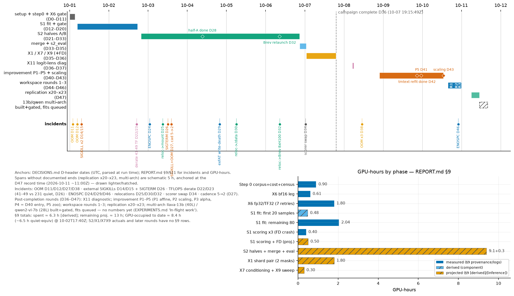
_figD10 — the campaign timeline (2026-10-01 → 10-11, parsed from DECISIONS.md D-headers): phase lanes and the
14 operational incidents that shaped the tooling (OOM storms, external SIGKILLs, the TFLOPS derate, two ENOSPC
events, two box relocations); inset: reported GPU-hours by phase from REPORT.md §9 (measured vs derived
marked). Schematic spans are disclosed in the figure footnote._

Supervisor lineage: memory guards → `gpu_guard.sh` (occupancy + speed probe + hang trip) → `fit_supervisor.sh`
for the multi-arch shards (wait-for-slot polling; early-OOM load-window trial — a candidate GPU is accepted only
if the process survives `EARLY_SECS=420` without an OOM marker, else kill and try the next GPU; `FIT_EXTRA` passthrough).

## In-flight work (not results)

Three follow-ups are open, none with numbers; two of them pin the interpretation of Stage 6:

- **E1 — the matched-sample task control** (Stage 7). The caption corpus's exact 100 images × 2 questions
  (1 present-object yes + 1 popular-absent no per image, from instances annotations) = a 198-answer manifest
  (as built: 99 samples over 99 images), then a matched-task lens fit at dim-batch 4 on the live box
  (`fits/llava-1.5-7b-hf-pope-matched`, resume-capable) and the dJ attribution. Verdict decides whether "fit on the
  analysis task" means task FORMAT or task DOMAIN (D50).
- **E5 — the penultimate-target refit.** `fit_llava --target-layer` (landed in `fit_masked`) exposes the vendored
  implementation's penultimate-target conditioning hint; a matched-lens refit at `target_layer = n_layers - 2`,
  scored by the same calibrated fidelity table (D50).
- **Register probe scale-up.** x26's n=20 finding (unembed-blind, probe-decodeable registers) needs the 300 held-out
  captions plus further COCO images before the non-verbal-workspace claim is a result rather than a pilot (D49).

Retired from in-flight: the multi-architecture extension is now **fitted and evaluated** (Stage 5): `fits/<model>`
holds both budgets for 7b/13b/qwen2vl with 20 step13 eval JSONs; the qwen gold-resolution caveat is removed by
D49's tokenizer-agnostic resolution, so cross-arch reruns no longer need a re-fit (D48/D49).

## What these results license (and what they do not)

**Can** (REPORT §12, updated by later rounds): token-level disposition readouts on **text positions** — per
layer, on fit corpora and held-out shards — including the **last-patch/last-prompt handoff**, where the
hallucination-prone commitment forms; comparative statements across layers, masks and corpora (J-lens vs logit
lens vs translators; text vs image masks; captions vs WikiText), given the metric caveats; a **causal edit
handle** (add/ablate/ swap with well-conditioned 2-column bases, cond ≤ 2.89; 215/1400 caption changes; the 90%
surgical cure at L30); training-free hallucination readouts (pre-generation gap 0.985, per-word lens entropy
0.730, fused image-level risk 0.666 — all single-forward, moments-only); and workspace structure claims
replicated on a VLM (band, lens>logit at mid, report rise, depth precedence, ignition, modality-split bands).
Stages 5–7 add: **calibrated** per-layer readouts as the deployment default (top1 agreement 0.24→0.61 at L20), for
absolute as well as comparative statements; a question-scale POPE mechanism story (model in the published band,
prior-vs-evidence gap readable only calibrated, final-layer image-free contrast 0.845 beating the model's own
margin 0.795 on adversarial); a **surgical, training-free mitigation arm** (prior-direction residual ablation at
the commitment layer: +1.7 POPE acc, CHAIR-neutral, mid-band object content intact — n=60); a cross-architecture
generality claim for the J-space properties (7b/13b/qwen2vl, both caption budgets); and the non-verbal-visual-
workspace claim, **conditional on a trained probe** (register content is probe-decodable but unembed-blind).

**Cannot**: "the J-lens dominates everywhere" — mid-layer needed the affine correction (D40 revising
D19/D39(c)); image rows as text predictors (V1/D36: the image→image cotangent mass is 24–255× larger, cos 0.39 →
0.09) or "the model sees X" claims from image-position readouts (D49/D50 add the sharper form: the registers are
unembed-blind *architecturally*, so a better J cannot verbalize them — only a trained head); absolute
pre-calibration readouts (over-dispersed by the 0.62–0.94 scale; ranking statements only, D49/D50); absolute
hallucination rates from rank/KL values (corpus- and instruction-conditional); ranking claims from mean rank alone
(the rank-vs-KL tension, D19/D43); attention-based hallucination prediction (NULL at power, D46); or "one lens per
model" — the caption→POPE task axis moves |dJ| 119% (10× the caption-budget axis), so cross-task absolute claims
need a task-fitted (at minimum task-validated) lens (D49 addendum).

## Hypothesis register

Numbered, testable, each with its evidence pointer; predictions are directional; tests are the cheapest
discriminating run on existing tooling.

- **H1 — Grounding-overtake intervention.** Boosting grounded categories at L20–25 text rows converts would-be
  hallucinations. Evidence: D44 X14 — true-object rank 1423 → 34 → 6–15 at the last prompt position
  (L16→L20→L22–25), crossing at L24–26; D44 X13 — ablation at those layers already removes 0.50–0.70.
  Prediction: an add-arm (the mirror of X13's ablate-arm) at L20–25 turns hallucinated captions grounded more
  often than decoding noise, below the α≈27 degeneration boundary (D40). Cheapest test: add an add-arm to
  `x13_cure_test.py` on the same 39 images (~1 GPU-h, no fitting).
- **H2 — Edits through the n=1000 translator.** Composing edit directions as `W_U[t] @ A_l J_l` matches J-vector
  edit efficacy and enables mid-layer cures at lower alpha. Evidence: D41 span overlap — J-vector top-64
  directions carry only 3.5–10.6% of `W_U`'s readout energy (3.4× chance at L30), explaining the 5–15× alpha
  cost; D43 — the n=1000 translator matches the J-lens at L30 (1.30) and dominates mid-layer (L16 1.45 vs 21.4).
  Prediction: the composed direction reaches the same change rate at lower alpha, and mid-layer (L16–24) cures
  become concept-directed rather than change-only. Cheapest test: recompose X13's mean-replacement directions
  through the `step8` n=1000 translator on the same 39-image cure set and compare dose-response arms.
- **H3 — Image-position probe distillation fails mid-band, succeeds at L28+.** Evidence: D47 finding B — image
  positions are sticky (z 9.2–18.6) but object-free until the motor regime (object-in-top10 0.000 → 0.069 at
  L31); D36 — image rows carry image→image cotangent mass (24–255×). Prediction: a linear probe on
  image-position states predicts the image's object set at chance through the mid band and above chance only at
  L28–31. Cheapest test: train a small probe on cached image-position states (D43's CPU-cache tooling) over ~200
  COCO images with COCO category labels.
- **H4 — Ignition-threshold micro-nudges.** Alpha just below a trial's flip threshold changes the committed
  class with minimal collateral. Evidence: D47 finding A — caption flip co-locates with the lens transition
  (Pearson 0.9887 at L28; threshold α 0.395 vs flip α 0.479). Prediction: sub-threshold perturbations flip the
  caption's committed class while leaving most tokens unchanged. Cheapest test: rerun the x23 harness with a
  fine alpha grid around each trial's threshold; count class flips vs collateral token edits.
- **H5 — The pre-generation gap generalizes beyond the fit question bank.** Evidence: D45/D46 X18 — AUROC 0.985
  on 185 questions of the 10-question bank (0.895 on the model's own hallucinated yes). Prediction: the gap
  signal holds across POPE subsets (random/popular/adversarial) and A-OKVQA yes/no, degrading only on
  adversarial splits. Cheapest test: run `x18_pope_handoff.py` on the vendored POPE splits (`data/pope.py`); one
  forward per question.
- **H6 — The sink-dim set is architecture-universal.** Evidence: D46 X16 — the BOS top-16 dim set is identical
  across L16–30, position-typed (image/text share 1512/2789/1076), BOS-clamp destructive (retention 0.278) while
  image dims are inert (0.94–1.00). Prediction: qwen2vl's census will show a single massive outlier group with a
  position-typed, band-stable dim set — now testable, because the qwen2vl lens exists (D48,
  `fits/qwen2-vl-7b-instruct`). Cheapest test: run the X3 census + top-16 dim extraction on the fitted qwen2vl
  lens — zero new method code. Note the band onsets already differ per model (13b L25, qwen L24, 7b L20: Stage 5),
  so the prediction is about the *shape* of the sink, not its depth.
- **H7 — The band boundary shifts with depth: CONFIRMED at n=3.** Evidence: D47 — 32-layer LLaVA-7B band L17–29
  within the mapped [12, 29]; the paper's deeper frontier models band [38, 92]. D48 Stage 5 now measures all three
  production models: top-1 onset/offset 7b **L20/L29**, 13b **L25/L36**, qwen **L24/L26**. Onset×(layers/32) =
  20, 31, 21 and offset 29, 45, 22.75 — 7b and qwen land within 3% of the 7b baseline fraction, but 13b's band
  runs ~10% deeper in fractional terms (onset 0.63 vs 0.75), so the "constant fractional position" form holds for
  same-family models and fails for the LLaVA-13b width change. Cheapest test: rerun the x22 structure arm on the
  remaining budget variant (`merged-64tok` for 13b) and check whether the 13b fractional shift is a width effect
  or a caption-budget effect.
- **H8 — Fusion of lens entropy + category gap improves with more images.** Evidence: D46 X19 — fused 0.666 at
  n=197 (27 positives), the components alone 0.620 and 0.632, failing on different images. Prediction: the
  z-scored fusion's AUROC rises with n as the components' errors decorrelate. Cheapest test: extend
  `x19_halluc_risk.py` to the 300 held-out captions plus further COCO images with the existing single-pass
  harness and refit the fusion.
- **H9 — The J-lens's L30 exactness makes it the preferred calibration reference for any translator.** Evidence:
  D19/D34/D42 — the L31 readout is the model exactly (identity 0.0; rank 27.31; KL 0.000) and the
  tmtext50+payload lens holds L30 ratio 1.30; D43 — translator quality is limited by the distillation target's
  fidelity. Prediction: distilling the translator against the L30 J-lens readout converges faster per sample at
  equal n. Cheapest test: refit the rank-32 translator at n=40/100 with the L30 J-lens output as target and
  compare the LQS curve to D43's 1.714/2.043.

- **H10 — The task effect is format, not image set.** Evidence: D49 addendum — caption→POPE-answer lenses differ by
  mean |dJ| 1.19 (min 0.30, band L16–28 0.51) vs 5–16% for the caption-budget axis; D50 — the effect is confounded
  with the image set until the matched control lands. Prediction: caption vs matched-POPE-on-the-same-100-images
  keeps a large |dJ| but smaller than 1.19, and the residual vs POPE-500 is the image-set part. Cheapest test: the
  running E1 fit (99 matched questions on the caption corpus's own images) plus a per-layer diff — zero new method
  code.
- **H11 — The image-free contrast generalizes beyond adversarial.** Evidence: D49 x24 — the final-layer image-free
  contrast ranks the model's errors at AUC 0.845 vs its own margin 0.795 on adversarial, and the answer-signed gap
  rises through the band (0.744–0.823 at L21–25, recomputed); the effect is calibration-invariant. Prediction: the
  contrast keeps its margin over the model's confidence on the 300 held-out captions and on the question-scale
  random/popular splits, shrinking on the yes-rate-inflated adversarial split. Cheapest test: reuse `x24_pope_microscope.py`
  with `--lens` pointing at the POPE-fitted lens (`fits/llava-1.5-7b-hf-pope`) and compare contrasts per split.
- **H12 — Early-layer-only refits recover the task lens.** Evidence: D50 addendum 2 — the per-layer task delta decays
  monotonically (2.63 at L0 → 0.36 by L28), so late-layer J's are task-agnostic at 0.3–0.5. Prediction: re-fitting
  only source layers 0–8 on a new task reproduces the full task-lens's calibrated readout within the D48 budget-noise
  band (5–16%) while cutting fit cost by ~3×. Cheapest test: run the E1 matched fit with a source-layer subset and
  compare the calibrated fidelity table against the full fit.
- **H13 — A trained head beats the unembed on register content, and the gap is causal.** Evidence: D50 E3/x26 — the
  transport preserves probe-readable register content while the unembed readout stays object-free at those
  positions (obj-in-top10 0.000–0.013); D49 — registers are causally inert at zero-ablation strength. Prediction:
  a probe head trained on register residuals improves downstream caption object recall under a decode-time readout
  rule, and a stronger (not zero) register intervention changes captions. Cheapest test: scale x26 to the 300
  held-out captions (D49's queued scale-up) and fit the decode-time probe head against CHAIR.
